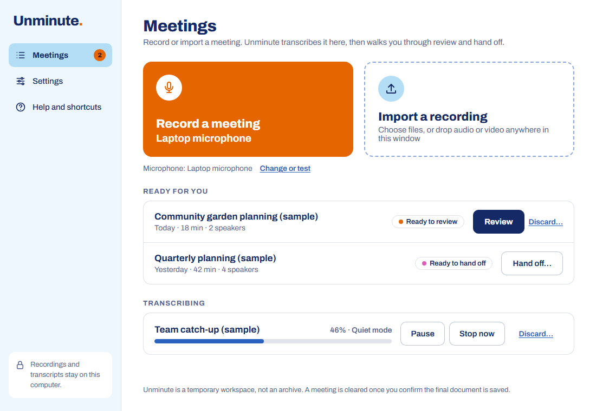
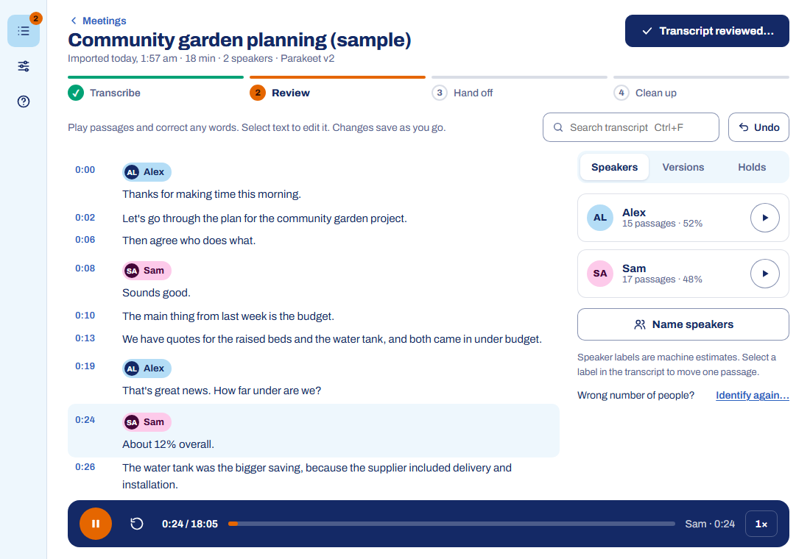
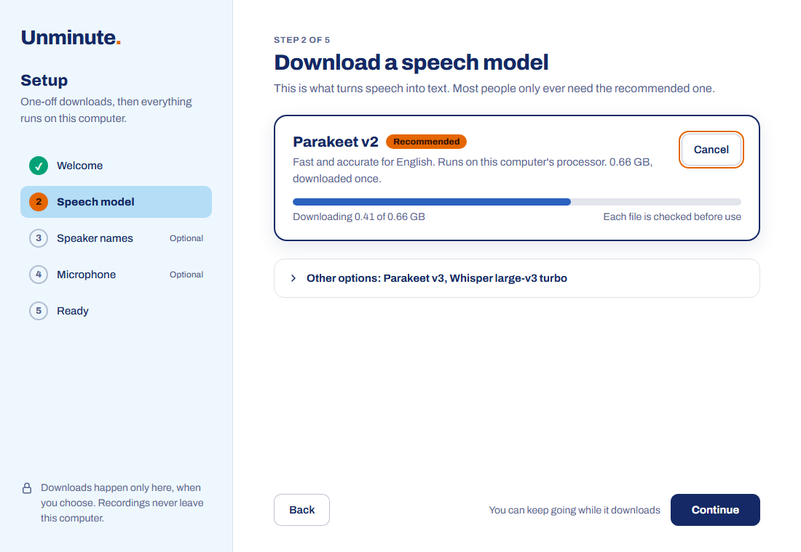
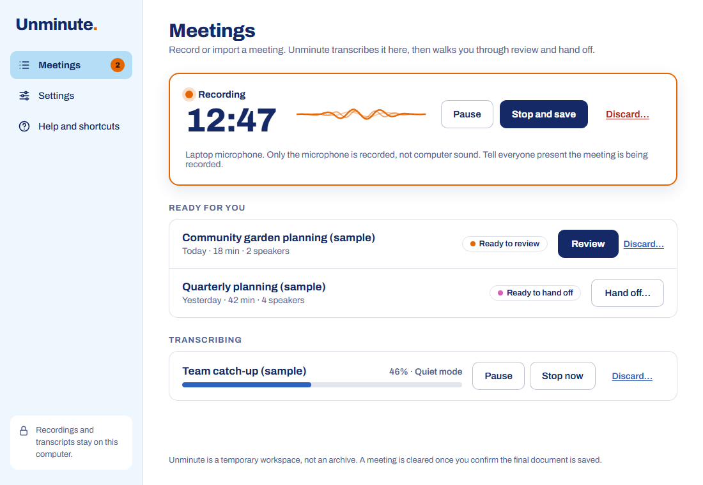
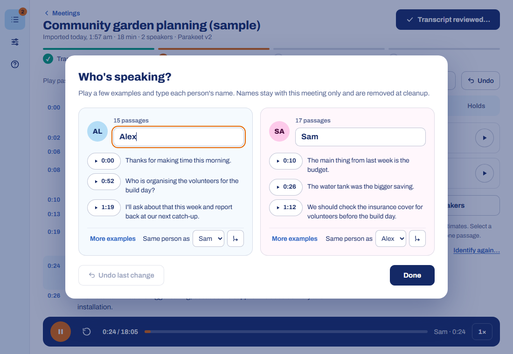
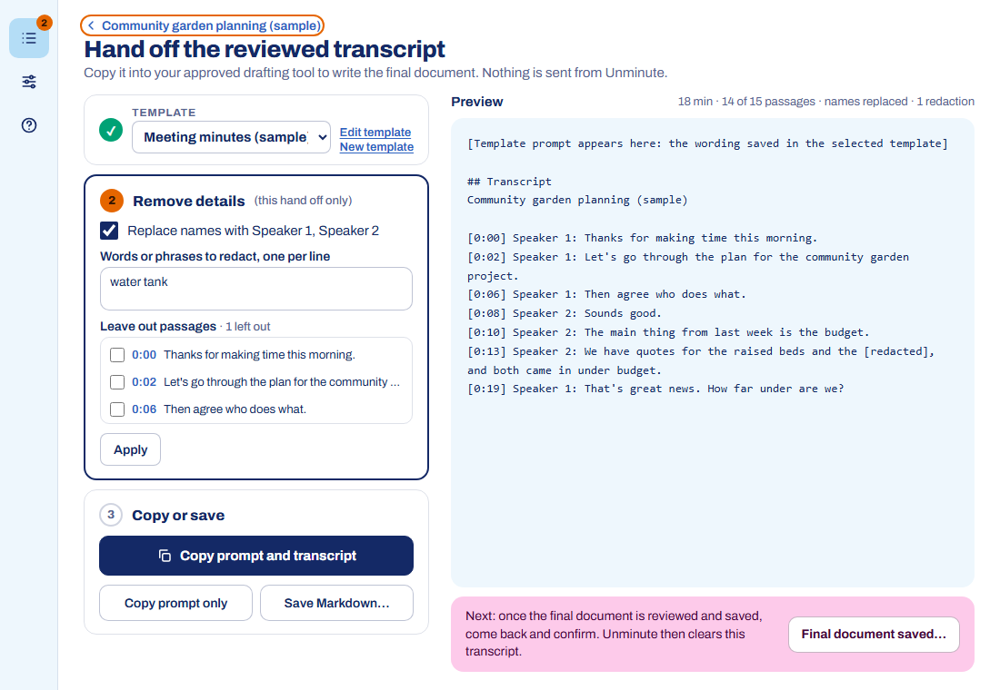
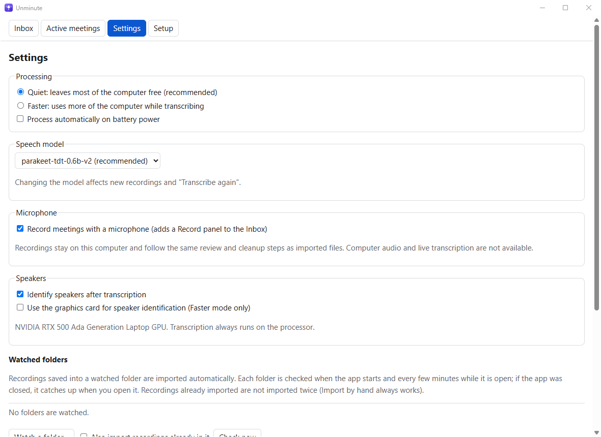
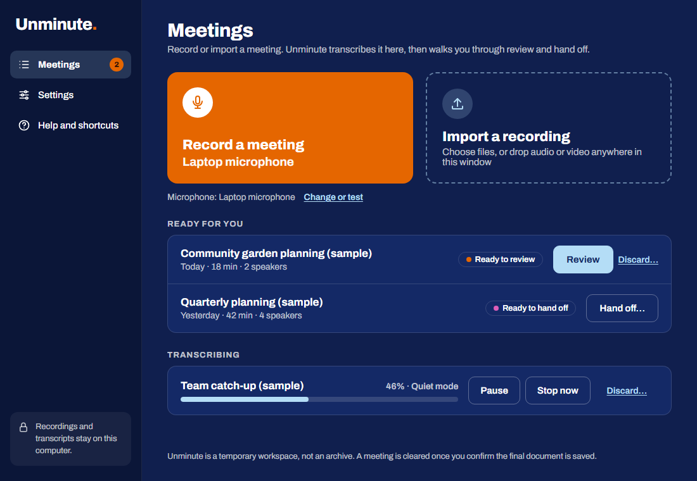

# Unminute

**Unlimit your meeting minutes.**

Unminute turns meeting recordings into reviewed transcripts on your own Windows computer. You review the transcript against the audio, name the speakers, and hand the text to your organisation's approved AI assistant to draft minutes. Then the app clears its working copies away. Transcription and speaker identification run on your computer, and nothing is uploaded.



It was built for a professional-services office where recordings are confidential, laptops are locked down (no administrator rights, Intune managed) and nobody wants to learn a command line. It installs per user, without administrator rights.

The screenshots show a fictional sample meeting: they are the app's own screens, filled with built-in sample data by `tools/design_check.py`. No real people, meetings or recordings appear in them.

## What it does

- **Transcribes on your computer.** Uses NVIDIA Parakeet (recommended for English) or OpenAI Whisper, on the processor, or Whisper on an NVIDIA graphics card if you add it. Accepts mp3, m4a, wav, mp4, mov, mkv, flac, ogg, aac, wma, webm and avi.
- **Works out who said what.** Optional speaker identification with pyannote. You name the speakers after listening to short clips.
- **Review against the audio.** Play the meeting from any passage, with the transcript following along. Correct text in place. Edits save automatically and can be undone, even after a restart.
- **Hands off safely.** Copies a prompt and the reviewed transcript for your AI assistant, or saves Markdown. For the hand off only, you can replace names with Speaker 1, Speaker 2, leave out passages or redact words.
- **Cleans up in two confirmed steps.** The audio goes once you confirm the transcript is reviewed. The transcript goes once you confirm the final document is saved elsewhere. Holds stop cleanup for as long as you need.
- **Fits around your work.** Recordings come from Import, drag and drop, watched folders or the microphone. Quiet mode leaves most of the computer free. Pause and resume are safe, and nothing already transcribed is lost after a crash.
- **Draft text while recording (optional).** Turn it on in Settings to see rough text of what is said a few seconds behind, kept in memory only and replaced by the full transcript when you stop.
- **Asks before it records.** Each recording starts only after you confirm that everyone present has been told (unless your organisation turns that question off), and the window title and taskbar button show while it is recording.
- **Stays offline.** Models are downloaded once, when you choose, and checked against published checksums. No usage statistics are ever sent.



## Requirements

- **Windows:** 64-bit Windows 11, or Windows 10 version 1809 or later, on an x64 processor. Testing so far has been on Windows 11 only.
- **Microsoft Edge WebView2 Runtime:** built into Windows 11 and present on most managed Windows 10 devices.
- **Disk space:** about 6 GB free.
- **Processor and memory:** the minimum is 4 cores and 8 GB of memory, and 8 cores and 16 GB are recommended. Below the minimum, the installer warns and asks before continuing (an unattended install records the warning and continues).
- **Graphics card (optional):** an NVIDIA card with driver version 580 or later can speed up speaker identification and Whisper transcription. It is not needed.

You do not need Python, Git, FFmpeg or any GPU tools. The package brings its own private runtime.

## Install

1. Download `Unminute-<version>.zip` and `Unminute-<version>.zip.sha256` from the [Releases page](https://github.com/thatskiff33/unminute/releases). The [latest release](https://github.com/thatskiff33/unminute/releases/latest) is the current full release. Previews, such as 0.5.0-preview.3, are marked Pre-release: they are for testing and never become the latest release. What changed in each version is in [CHANGELOG.md](CHANGELOG.md). 0.5.0-preview.3 keeps the storage format of 0.5.0-preview.2, so it updates that preview in place and keeps your meetings, edits, holds and settings.
2. Extract the zip.
3. Double-click `install.cmd`.

The installer checks the requirements and every file in the package, then installs for your Windows account only. It adds an **Unminute** shortcut to the Start menu. Installation takes a few minutes, mostly checking files.

Before extracting, you can check the zip against its `.sha256` file. In PowerShell, in the download folder, the two values printed must match:

```powershell
(Get-FileHash Unminute-<version>.zip -Algorithm SHA256).Hash
Get-Content Unminute-<version>.zip.sha256
```

That detects a damaged download, not a replaced one. From 0.5.0 (including its previews), each release is built by GitHub Actions from its tagged commit, with signed build provenance and a signed software bill of materials, and is published only after the project owner approves it. The zip itself is still not code-signed. To check that a download was built that way, IT can run `tools\intune\Get-VerifiedRelease.ps1` (add `-AllowPrerelease` for a preview); see "Verifying a release before packaging" in [docs/PACKAGING.md](docs/PACKAGING.md).

Unattended and Intune deployment, exit codes, detection rules and signing are covered in [docs/PACKAGING.md](docs/PACKAGING.md). IT teams can start from [docs/IT_DEPLOYMENT.md](docs/IT_DEPLOYMENT.md): install modes, managed policy, health monitoring, updates, offboarding and incidents.

Some behaviour described in this README is in the latest code but not yet in a release: Copy and open ChatGPT; encryption of the workspace database, the handoff templates, each meeting's working copy of the audio and microphone recordings as they are saved; the locked workspace when Windows will not unlock its key; the message for a data folder linked to a folder that cannot be reached; the audit log with its Windows event log copy and `--verify-audit`; offboarding for IT (`--offboard-report`, `--offboard` and `uninstall.ps1 -Offboard`); decoding with audio decoders only, and refusing recordings with an unusual sample rate or far more audio than their size can hold; refusing more broad folders for watching, and the note for recordings whose paths are too long; the installer's refusal of a custom install folder that holds other files; and the retention reminders ("Review due" and "Action required"). The next release comes only once all of the encryption work (#111 phase C) is finished. The [user guide](docs/WORKSPACE_GUIDE.md) lists what 0.5.0-preview.3 does instead.

### Coming from 0.4.3 or earlier

This is not an update in place, and nothing carries over. The app's folders, install folder and saved-token name changed with the rename to Unminute, so this version starts with an empty workspace and cannot see your meetings, settings, handoff templates, watched folders or remembered token in the earlier version. In order:

1. **Finish with the earlier version.** Hand off or copy anything you still need, confirm the cleanup of finished meetings, and check any holds with whoever manages them.
2. **Remove the Hugging Face token** there, because no later version can reach it: in 0.4, Settings > Manage downloads > Remove the remembered token; in 0.2 or 0.3, Setup > Remove the remembered token.
3. **Note what you set up.** Write down your settings and watched folders (including which ones may delete originals), and copy the text of any handoff template you edited or wrote.
4. **Uninstall the earlier version** in Settings > Apps.
5. **Install this version.** If IT manages your updates, they pass `-Managed` again on this first install.
6. **Set up again.** In Setup, download the models again and enter the token again. Then set up your settings, handoff templates and watched folders again. When you add a watched folder again, leave "Also import recordings already in it" unticked, so recordings you finished are not imported twice. If you used the graphics card, download the components you used ("Graphics card acceleration", "Graphics card for Whisper" or both) again in Settings > Manage downloads and turn "Use the graphics card" back on.

The earlier version's workspace and models stay on the computer until you delete them. Where they are, how to remove a token left behind, what happens if you install in the other order, and the steps for Intune are under "Updates" in [docs/PACKAGING.md](docs/PACKAGING.md).

### First start: Setup

The first start opens Setup, five short steps. Each model is a one-off download that the app checks before use.

1. **Welcome:** how a meeting moves through the app.
2. **Speech model:** Parakeet v2 is recommended (0.66 GB). Parakeet v3, Whisper large-v3 turbo and Whisper large-v3 are under Other options.
3. **Speaker names (optional, 0.03 GB):** the speaker identification model's publisher asks you to accept its terms with a free Hugging Face account and a "Read" token, once. Setup links to each page. The token can be remembered in Windows Credential Manager and removed at any time. Downloaded models keep working without it.
4. **Microphone (optional):** turn on recording and test the microphone.
5. **Ready:** a summary of what is set up.

You can skip the optional steps and turn them on later in Settings. Two graphics card components are offered only on computers with an NVIDIA card, in Settings > Manage downloads. **Graphics card acceleration** is a 2 GB download of the CUDA build of PyTorch, used for speaker identification. **Graphics card for Whisper** is a 0.57 GB download of NVIDIA's cuBLAS library, used to run Whisper on the card. Either one works on its own, and both are used only in Faster mode once "Use the graphics card" is on. That page also checks, repairs and removes downloaded models.



## Everyday use

### Bring in a recording

- **Import a recording** on the Meetings page, or drop audio or video files anywhere on the window. Recordings must be on this computer: files on mapped network drives, or reached through a symbolic link, are refused (copy them across first), unless your organisation allows them. Synced folders such as OneDrive are fine.
- **Watched folders** (Settings) pick up new recordings automatically. Pausing a folder stops its imports at once; what it had already found waits until you resume it. Watch the specific folder your recordings are saved in: a whole drive, your user folder or any folder that holds it (such as `C:\Users`), `AppData` and every folder inside it, the Windows and program folders and Unminute's own data folder are refused. A recording whose full path is too long for Windows to open is counted in the folder's note, and the rest of the folder is imported as usual. See [docs/INTAKE.md](docs/INTAKE.md) for synced and cloud folders.
- **Each recording is opened in a separate, restricted process** that can only send back plain audio. Only the supported formats, and only the audio decoders they need, are used, whatever a file claims to be: a video track or cover art is never decoded. Decoding stops at 12 hours of audio and always leaves 1 GB of disk space free. A file with a sample rate below 4 kHz or above 384 kHz is refused, and so is one that would decode to more than a second of audio per 16 bytes of file (far more than any real recording holds). A file with several channels (for example one track per person) is mixed with every channel at equal weight, so no track is lost.
- **Record a meeting** appears once microphone recording is on (Setup, or Settings > Recording and speakers). It records the microphone and, if you turn on **Also record computer audio** (off by default; your organisation can turn it off), the sound playing on the computer, such as the other side of a Teams or Zoom call. That includes notification sounds and anything else the computer plays. The two tracks are mixed into one recording when you stop.
  - **Before each recording**, Unminute asks you to tick that everyone present (with computer audio, also everyone on the call) has been told the meeting is being recorded, and why. The question is drawn by the app outside its page. Your organisation can turn it off.
  - **While recording**, the window title starts with **● Recording** and the taskbar button shows a red dot, also when the window is minimised.
  - **The computer stays awake** while a recording is open, unless your organisation's power settings prevent it. If it sleeps anyway, for example when the lid is closed, the recording stops, keeps what was recorded and says the computer went to sleep.
  - **To keep recording with the lid closed**, turn on **Keep recording when the lid is closed** in Settings > Recording and speakers. Unminute then sets Windows to do nothing when the lid is closed while a recording is open, and puts your own setting back when the recording ends. If the app closes unexpectedly, it puts the setting back at its next start, or when you uninstall it. When you open the lid, the recording card says how long it carried on with the lid closed. Where your organisation sets what the lid does, Unminute leaves it alone. The lid and sleep behaviour has not yet been tested on a real laptop.

Transcription runs in the background, one meeting at a time. The Meetings page groups meetings by what they need next: **Needs attention**, **Ready for you**, **Transcribing** and **Cleaning up**. Transcribing meetings show progress, with **Pause** and **Stop now**.

Parakeet now keeps speech separated by pauses of up to a second together, so it hears each phrase with more of its context and recognises more words than in 0.4.3: on eight public meeting recordings its word error rate fell from 24.0% to 21.2% (see [Measured performance](#measured-performance)). A sentence that two people share is now slightly more often given one speaker's label.



### Review and name speakers

Open a meeting to review it. The steps (Transcribe, Review, Hand off, Clean up) run across the top, with the next action beside them.

- Select a time to play from that passage; the player at the bottom carries on through the meeting. While the audio is kept, Space plays or pauses, and J and K move between passages.
- Select text, or press Enter, to correct it. Ctrl+Z undoes the last edit.
- Search with Ctrl+F. In a wide window the transcript and the side panel scroll separately.
- You can open a meeting while it is still transcribing. New passages are added to the end as they arrive, so scrolling, playing and correcting earlier passages stay smooth on long meetings.
- **Name speakers** plays short examples for each detected speaker. You can merge two labels that are the same person, or move a passage to another speaker. Names stay with this meeting only.
- **Skip speakers** (on the meeting's row) or **Skip speaker identification** (in its speaker panel) is for a recording of one or two people: the meeting goes straight to review and hand off without speaker labels. While the audio is kept, **Identify again…** still works later.
- The side panel's tabs show **Speakers**, **Versions** (Transcribe again with another model keeps your earlier version and its edits) and **Holds**. A meeting that stopped with an error can also be transcribed again, with the model now chosen in Settings.
- **Help and shortcuts** in the sidebar lists every keyboard shortcut. Press ? (outside a text field) to open it.



### Hand off and clean up

Each meeting shows its steps:

1. **Transcript reviewed…** saves the reviewed text and removes the app's copy of the audio. If you allowed it for the watched folder a recording came from, the original there is removed too (unless your organisation has turned that off, which keeps originals). Playback and editing end here.
2. **Hand off…** opens a page that shows exactly what will be copied. Choose a template, then remove details for this hand off only: replace names with Speaker 1, Speaker 2, redact words, or leave out passages, and select **Apply**. Then **Copy and open ChatGPT**, **Copy prompt and transcript**, **Copy prompt only** or **Save Markdown…**.
   - **Copy and open ChatGPT** copies the prompt and transcript, then opens chatgpt.com in your default browser. Sign in with your organisation's business account (not a personal one), paste with Ctrl+V, check it and send. Unminute sends nothing, puts nothing in the web address and does not type into the browser. Your IT team can rename the button and point it at another assistant, or turn it off (`docs/PACKAGING.md`).
   - **Templates:** Minutes and actions, Short summary, Action list, Board or directors' minutes, Client meeting file note, Follow-up email, and Team or WIP notes. You can edit them or add your own. The built-in ones ask the assistant to write as a minute-taker would, with no timestamps, using what its connected tools can read about the meeting, and to list the points you should check.
   - **Every hand off**, including your own templates, asks the assistant to use its tools only to read, to change nothing unless you ask, and to treat the transcript and what its tools return as information, not instructions. These are requests to the assistant, not guarantees. With names replaced, it also asks the assistant not to work out who the speakers are.
   - **A saved file** is named by the date and time the meeting was imported (`Meeting transcript YYYY-MM-DD HH-MM.md`), not by its title unless your organisation allows that, and marks the transcript as data in the same way as the copied text.
3. **Create the final document** in your assistant, review it yourself, and file it where your organisation keeps such documents.
4. **Final document saved…** removes the meeting's transcript, edits and speaker names. A minimal receipt (a random number, times and the result) is kept for 30 days.



Copying or saving never deletes anything by itself, and the app does not clear your clipboard unless your organisation has set it to clear the app's own copies after a set time. Cleanup cannot reach copies in synced folders, on a phone or recorder, or anything you shared with another service.

- **Holds.** Hold a meeting's audio, transcript or everything, with a reason. A hold stops the matching cleanup and never expires by itself. Releasing it deletes nothing: the cleanup waits for you to confirm it again.
- **Retention reminders.** A meeting whose next step (review, hand off, or confirm or finish cleanup) has waited 30 days or more shows "Review due" on the Meetings page, with a banner, while the app is open. Your IT team can change the number of days and turn on "Action required". Nothing is blocked or deleted, and a step a hold blocks shows no reminder. Not yet in a release; details in the [user guide](docs/WORKSPACE_GUIDE.md#retention-reminders).
- **Discard….** A test or wrong recording can be discarded before its review is confirmed. Discard is refused while a hold is active, and your original recording file is never deleted.

The full walkthrough is in the [user guide](docs/WORKSPACE_GUIDE.md).

## Settings

- **Processing:** Quiet (the default) leaves most of the computer free. Faster uses more of it. On battery, automatic work waits unless you allow it.
- **Speech model:** which model new meetings use, and **Manage downloads** for models and the graphics card components. A model that is not ready is marked "(not downloaded)" or "(damaged)", as on the Downloads page. Choosing one still saves the choice, and a note beside the picker says how to download or repair it.
- **Recording and speakers:** microphone recording, naming speakers after transcription, the curve shown while recording (Flowing wave, Spectrum or Sound wave), the graphics card for speaker identification and Whisper (Faster mode only) and **Keep recording when the lid is closed**.
- **Watched folders, Updates, Cleanup receipts.**

On a managed computer, IT can set some of these by policy. Settings then says that some settings are managed by your organisation, and those controls cannot be changed.



The window follows Windows' light or dark mode.



## Privacy and network behaviour

- **Transcription and speaker identification never use the network.** While processing, the app refuses its own Python network connections, DNS lookups and UDP traffic to anything outside the computer, including connections made through Windows' asyncio route. `--self-test` checks all three. This guard is not a firewall: native code opening its own sockets would not be caught. For managed devices, an outbound firewall rule is the stronger control.
- **Recordings are decoded in a restricted process.** It runs at Windows' Low integrity level inside a Windows job, cannot write your files or start programs directly, and is limited to 2 GB of memory. It can still read files you can read, so a decoder flaw would mainly be a privacy risk, and nothing in the app yet stops native code in it using the network: an outbound firewall rule for the app's runtime is the control for managed devices (#299 tracks a stricter sandbox).
- **The page inside the window is held in.** It cannot show its own message boxes, ask for the microphone, camera or screen, or call anything in the app except a fixed list of checked actions. Recording starts only through the app's own confirmation. Python's remote debugging, which would let another program run code inside the app's Python processes, is switched off.
- **No usage statistics are sent.** Before its libraries load, the app forces their telemetry switches off: Hugging Face, pyannote's usage metrics and OpenTelemetry. A setting in your environment cannot turn them back on. It also switches off ONNX Runtime's Windows telemetry events in the processes that use it.
- **Downloads happen only in Setup or Manage downloads, when you choose.** Models come from Hugging Face (huggingface.co and its download hosts under huggingface.co and hf.co), the optional graphics card component for speaker identification from download-r2.pytorch.org, and the optional graphics card component for Whisper from files.pythonhosted.org, where NVIDIA publishes it (that download only may reach that host). The download process can reach only those hosts, over HTTPS on its standard port, and any proxy configured for you: every request and every redirect is checked, also through a proxy. Certificates are checked against the Windows certificate store, so downloads work behind a firm's TLS-inspecting proxy. A fixed proxy (set in Windows or with HTTPS_PROXY) is used; a proxy given only by an automatic configuration script (PAC or WPAD) is not, so IT may need to set a fixed one or pre-stage the models. Each file is checked against a published checksum.
- **Meeting content is encrypted on this computer.** Transcripts, edits, speaker names and other meeting text in the workspace database, your handoff templates, the app's working copy of each meeting's audio and microphone recordings as they are saved are encrypted with AES-256-GCM, under keys that Windows protects for your account on this computer. Settings, the content-free logs, a recording's journal (times, events and the microphone's name) and the times, states and counts the app needs to run are not encrypted. Anything running as you can still read what the app can, and BitLocker is still needed for everything else on the disk. If Windows will not unlock the key, Unminute opens locked: it reads none of your meetings and never shows them unencrypted. Not yet in a release; details in [docs/ENCRYPTION.md](docs/ENCRYPTION.md).
- **The Hugging Face token** is used only for the speaker model download. It is passed to the download process privately, never on its command line or in its environment. A token set in your Windows environment is not used or passed on: paste it in Setup instead.
- **A small local diagnostics log, with no content.** The app keeps content-free logs in the workspace's `logs` folder (about 1.5 MB for each of its processes): error types, where in the code they happened, timings and version numbers, never meeting text, titles, names or folders. Nothing is sent anywhere. An unexpected error shows a code, for example "Something went wrong (code U-1A2B3C)".
- **An audit log of what was done, with no content.** The app records when each meeting is imported or recorded (with the recording confirmation), reviewed, handed off, held, cleaned up or discarded, and when watched folders and permission to delete originals change: the kind of action, the time, the app's own reference numbers and counts, never text, titles, names or folders. Each entry carries a fingerprint of the one before, and a copy of each fingerprint, with your Windows account, goes to the Windows event log, which your IT team may collect (see "What Unminute records about your work" in the [user guide](docs/WORKSPACE_GUIDE.md)).
- **Outside the app's control:** recordings in synced folders such as OneDrive are already in that service, and anything you paste or upload to an AI assistant is handled by its provider under your organisation's account and policies.

The threat model, the controls in place and the remaining risks are in [docs/SECURITY_MODEL.md](docs/SECURITY_MODEL.md). To report a vulnerability, see [SECURITY.md](SECURITY.md).

## Where things live

| What | Where |
| --- | --- |
| Program | `%LOCALAPPDATA%\Programs\Unminute\versions\<version>` |
| Workspace (meetings, edits, holds, settings) | `%LOCALAPPDATA%\Unminute\workspace` |
| Models, and the optional graphics card components | `%LOCALAPPDATA%\Unminute\models` |
| Diagnostics logs (no meeting content) | `%LOCALAPPDATA%\Unminute\workspace\logs` |
| Audit log (no meeting content) | `%LOCALAPPDATA%\Unminute\workspace\audit`, and a copy of each entry's fingerprint in the Windows Application log |
| Hugging Face token (if remembered) | Windows Credential Manager |
| Start menu shortcut | Unminute |
| Version 0.4.3 or earlier, if it was installed | Its own folders, kept until you delete them (see "Updates" in [docs/PACKAGING.md](docs/PACKAGING.md)) |

`%LOCALAPPDATA%` is per user, needs no administrator rights and is not synced by OneDrive. All of Unminute's data is under `%LOCALAPPDATA%\Unminute`: uninstalling keeps it, and the install folder must not overlap it. A custom install folder must also be new, empty or an existing Unminute install: the installer refuses a folder that already holds other files, and removes only the versions it installed. Only its `models` folder may be redirected elsewhere; Unminute will not open a workspace that a junction or link puts in OneDrive or on a network drive, or one whose junction or link points to a folder that cannot be reached; it says so and asks the user to contact IT.

## Updates, rollback and uninstall

- **Update:** run the new package's `install.cmd` with the app closed. An update that keeps the storage format keeps everything. One that changes it waits until the workspace is empty (no meetings in the workspace, active holds, unfinished cleanup or unimported microphone recordings), and says what it is waiting for. No update expires a hold, deletes your work or makes a backup copy of it. A workspace the update check cannot read, for example a damaged one, makes the update wait; it is never treated as a fresh install. From 0.4.3 or earlier this is not an update in place: see [Coming from 0.4.3 or earlier](#coming-from-043-or-earlier).
- **Rollback:** the previous version is kept. To return to it, run `install.ps1 -Rollback` from the current version's folder (`versions\<version>`). Rollback is refused if the previous version cannot open your workspace, for example after a storage-format change. The first version after the rename has no earlier version in its install folder to roll back to: to go back to 0.4.3, uninstall this version and install 0.4.3 again, which opens its own workspace.
- **Uninstall:** Settings > Apps > Unminute. The workspace and downloaded models are kept, because meeting content is only removed through the app's confirmed cleanup steps. If Unminute closed unexpectedly while it had set Windows to do nothing when the lid is closed, and did not start again, the uninstaller first puts your own lid setting back; if it cannot, it says to check the setting in Windows Settings. When a person leaves, IT can remove their workspace, models and token, as that user and only once no meeting, hold, unfinished cleanup or recording is left, with `--offboard`, or with `uninstall.ps1 -Offboard`, which then uninstalls too: see "Offboarding" in [docs/IT_DEPLOYMENT.md](docs/IT_DEPLOYMENT.md).

Details are in [docs/PACKAGING.md](docs/PACKAGING.md).

## Troubleshooting

| Problem | What to do |
| --- | --- |
| A model shows "Damaged" or "Needs attention" | Settings > Manage downloads (the Downloads page) > Repair. The damaged copy is kept aside, not deleted. |
| A meeting stopped because its speech model is not ready | Choose a downloaded model in Settings > Speech model and select **Transcribe with another model…** on the meeting's row. Or download or repair the model in Settings > Manage downloads, then select **Try again**. When your organisation has turned downloads off, any model has to be installed by your IT team. |
| Speaker identification did not work | The transcript is still usable. Check the speaker model in Settings > Manage downloads, then use Identify again in the meeting's Speakers tab. When your organisation has turned downloads off, the message says so: ask your IT team to install or repair the speaker model. |
| A watched recording is not imported | Settings > Watched folders lists files still copying, cloud-only files and unreadable files. |
| Nothing is processing on battery | Plug in, or allow processing on battery in Settings. |
| The installer says the app is running | Close Unminute and run it again. |
| An update is waiting | Settings > Updates lists what it is waiting for. |
| "Something went wrong (code U-…)", or the app closed by itself | Open **Help and shortcuts**, select **Copy diagnostics** and paste them into your support request with the code. They hold versions, settings, counts and error locations, never meeting content, names or folders. |
| A message says Unminute found damage in its workspace database | After an unexpected close, Unminute checks its database at the next start and holds processing, imports and cleanup if it finds damage. Follow [If Unminute finds damage](docs/WORKSPACE_GUIDE.md#if-unminute-finds-damage) in the user guide. |
| A message says Windows could not unlock Unminute's encryption key | Unminute opens locked and keeps your meetings as they are. Close it, sign out of Windows and back in, then open it again. If it stays locked, follow [If Unminute cannot unlock its workspace](docs/WORKSPACE_GUIDE.md#if-unminute-cannot-unlock-its-workspace) in the user guide. Not yet in a release. |
| A title, passage, name or note shows "[Could not be read]" | That part of the workspace is damaged, or was changed outside Unminute. The rest of the meeting is shown and can be discarded or finished, but nothing is made from it. Tell your IT team. Not yet in a release. |
| A message says Unminute's workspace folder is redirected into OneDrive or to a network drive | Ask your IT team. The workspace stays on this computer, outside synced folders; IT may move only Unminute's models folder (see [docs/PACKAGING.md](docs/PACKAGING.md)). Recordings in OneDrive still import and can be watched. |

For IT support, `runtime\python.exe -I -B -m workspace --self-test` in the installed version folder checks that the main dependencies load, that the network block works, that the speaker model loader refuses a model file that would run code and that Windows can protect and unlock a key for this account. `--status` prints counts and states only, never content. `--health` prints a one-line health report for device management and exits 1 when the app needs attention. `--verify-audit` checks the audit log's chain, and with `--event-log` compares it with its Windows event log copy (see [docs/PACKAGING.md](docs/PACKAGING.md)).

## Measured performance

On an otherwise idle Intel Core Ultra 7 255H laptop (32 GB), with 5 minutes of synthetic speech:

| Engine | Processor, Quiet (4 threads) | NVIDIA RTX 500 Ada laptop GPU |
| --- | --- | --- |
| Parakeet v2 | 12.2 s | 32.4 s (slower) |
| Whisper large-v3 turbo | 199 s | 47.6 s |

Word error rate on 148 public clips (21.5 minutes), measured before #107: Parakeet v2 15.9%, Whisper turbo 14.8%, Parakeet v3 18.9%. That is a small public sample, not New Zealand business audio. Parakeet v2 on the processor is the default. The graphics card can speed up speaker identification and Whisper: speaker identification on a 15-minute test recording took 80 s instead of 435 s (14 October 2026). On a 17.5-minute public meeting (AMI ES2004a), Whisper turbo took 47.4 s instead of 365.8 s, and Whisper large-v3 173.0 s instead of 1,708.6 s and 1,843.2 s in two processor runs with other work running (20 October 2026, RTX 500 Ada with 4 GB, #248). Details are in issue #12 and [docs/RELEASE_CHECKLIST.md](docs/RELEASE_CHECKLIST.md).

On eight whole public meetings (AMI, 254 minutes), Parakeet v2 had a word error rate of 24.0% at 20 times real time, and 21.2% since its speech detection bridges pauses of up to 1 second (#107; on four meetings not used to choose that setting the gain was 1.4 points); Qwen3-ASR-1.7B, a candidate engine not yet in the app, had 19.4% at 3 times real time but needed about 11 GB of memory. The NPU on the test laptop could not run any engine reliably. Method and full results: [docs/ENGINE_EVALUATION.md](docs/ENGINE_EVALUATION.md).

## Known limitations

Checks that need people, hardware or IT are tracked together in #189.

- Not yet tested on a clean standard-user Windows profile, through Intune on a managed device, or on Windows 10.
- The zip and the installer scripts are not code-signed. From 0.5.0, releases carry signed build provenance and a signed software bill of materials instead (see [Install](#install)); earlier releases rest on the published `.sha256` and the installer's per-file check.
- Transcription quality has been measured on public and synthetic audio only, not on representative business recordings.
- Not yet tested with a screen reader, Windows contrast themes or pilot users.
- Tested on one laptop only. The minimum and recommended hardware levels are untested.
- Graphics card acceleration has been tested on one NVIDIA laptop GPU (RTX 500 Ada, 4 GB): speaker identification with synthetic audio (14 October 2026) and a public meeting recording (17 and 19 October 2026), Whisper with public meeting recordings (20 October 2026). Whisper on the card needs a card CTranslate2 can run at float16, which its documentation puts at compute capability 7.0 or later; on an older NVIDIA card Whisper runs on the processor and the meeting says so. Whisper large-v3 on the card can give slightly different text from the processor: on a 39-minute public meeting (AMI ES2004c), 11.8% of words differed, and the word error rate was 21.76% on the card in one direct run and 20.02% through the app, against 19.75% on the processor. AMD and Intel graphics are not supported.
- Keeping the computer awake, and recording with the lid closed, follow Windows' documentation and have not yet been tested on a real laptop.
- Recording with the window visible uses about 23% of one processor core: 22.6% (median of three runs) in a release-mode check on the Intel Core Ultra 7 255H laptop with a 60 Hz display on 23 October 2026, with the recording display redrawing about 60 times a second. Minimised, it used 0.65%. Most of it is the browser drawing the moving recording display. #124 proposed 5% with the window visible; the release budgets are 25% visible and 1% minimised, chosen to keep the display's full look (#216). Minimise the window while you record if you do not need to watch it.
- The package now includes licence texts for the packages that ship none and for every bundled native library; components compiled into other libraries are not yet listed (#176).
- Version 0.5.0 and its previews are not an update in place from 0.4.3 or earlier ([Coming from 0.4.3 or earlier](#coming-from-043-or-earlier)).

What a release must meet is in [docs/RELEASE_STANDARD.md](docs/RELEASE_STANDARD.md). The evidence recorded so far is in [docs/RELEASE_CHECKLIST.md](docs/RELEASE_CHECKLIST.md).

## For developers

Both Codex and Claude Code read the shared [agent guidelines](AGENTS.md) natively (Claude Code 2.1.277 or later, which needs the repo to have no `CLAUDE.md`). Routine tooling traps are in [docs/DEVELOPER_NOTES.md](docs/DEVELOPER_NOTES.md).

| Path | Purpose |
| --- | --- |
| `workspace/` | Unminute: SQLite state, durable chunked processing, managed workers, cleanup and holds, intake, recording, the pywebview shell (`workspace/ui/`, with Archivo bundled under its OFL licence) |
| `workspace/asr_engines.py` | Shared engine interface for Parakeet and Whisper; model manifests, verified install and repair |
| `workspace/offline_guard.py` | Forces library telemetry off and refuses non-local network access outside deliberate downloads |
| `packaging/` | Installer and uninstaller for the package: per user, or for everyone on a computer with `-Machine` (on `main`, not in a release yet) |
| `tools/build_package.py` | Builds the versioned zip with a private CPython 3.14 runtime |
| `tools/make_icon.py` | Draws the app icon with Pillow: `python tools/make_icon.py unminute.ico preview.png` |
| `tools/` | Real-engine checks, UI and accessibility checks, the design comparison (`tools/design_check.py`), benchmarks |
| `tests/` | Unit tests: run them with `python tools/run_tests.py` (see [AGENTS.md](AGENTS.md), "Checks") |
| `.github/workflows/` | The checks on every pull request, and the Release workflow, which builds a tagged release on GitHub, attests it and publishes it after the owner approves |
| `CHANGELOG.md` | Release notes, one section per version. The Release workflow reads it. |
| `changelog.d/` | Unreleased changes, one fragment per pull request; `tools/changelog.py` moves them into `CHANGELOG.md` at release. |

Design and plans:

- [docs/WORKSPACE_DESIGN.md](docs/WORKSPACE_DESIGN.md): the durable processing core.
- [docs/design/boards/](docs/design/boards/): the approved UI design boards that `tools/design_check.py` compares the app against.
- [docs/history/](docs/history/): the original product plan and coding sequence, and the desktop shell trial's evidence, kept for history and no longer maintained.
- [docs/SECURITY_MODEL.md](docs/SECURITY_MODEL.md): threat model, trust boundaries, controls and residual risks.
- [docs/CONTROL_MATRIX.md](docs/CONTROL_MATRIX.md): each invariant and threat with its control, guard test and evidence, kept in step by `tests/test_consistency.py`.
- [docs/IT_DEPLOYMENT.md](docs/IT_DEPLOYMENT.md) and [docs/PRIVACY_IMPACT_ASSESSMENT_DRAFT.md](docs/PRIVACY_IMPACT_ASSESSMENT_DRAFT.md): the IT deployment guide, and a factual draft for a deploying organisation's own privacy impact assessment.
- [docs/RELEASE_STANDARD.md](docs/RELEASE_STANDARD.md), [docs/RELEASING.md](docs/RELEASING.md) and [docs/VALIDATION_RUNBOOK.md](docs/VALIDATION_RUNBOOK.md): release criteria, release process and hands-on checks.

Dependencies are hash-locked on purpose: `requirements.in` lists the direct ones, and `tools/lock.py` writes `requirements.txt` with every package and its SHA-256 hashes (see [docs/RELEASING.md](docs/RELEASING.md)). If you upgrade torch, torchaudio, pyannote.audio or huggingface_hub, re-test speaker identification end to end with a non-sensitive recording: `tools/packaged_check.py` runs the full lifecycle (import, transcription, speakers, review, cleanup) with real models from a built package, and `tools/durable_core_check.py` checks the workspace's processing core. The workflows in `.github/workflows/` run the automated checks on pull requests; [docs/RELEASE_STANDARD.md](docs/RELEASE_STANDARD.md) lists every gate and where it runs. CI does not run the models.

## Licence

This project is released under the [MIT Licence](LICENSE).

The repository contains this project's own code, plus one third-party wheel (`proxy_tools`, MIT) in `packaging/wheels/` because its publisher provides no wheel. No model weights are redistributed. The release package includes the official embeddable CPython 3.14 runtime (Python Software Foundation Licence) and the pinned packages from PyPI, each under its own licence. Models are downloaded in Setup from Hugging Face. The main components are listed below, verified on 17 September 2026 unless noted.

| Component | Licence | Notes |
| --- | --- | --- |
| OpenAI Whisper (model architecture and original weights) | MIT | |
| dropbox-dash/faster-whisper-large-v3-turbo (formerly mobiuslabsgmbh) | MIT | CTranslate2 conversion of openai/whisper-large-v3-turbo |
| Systran/faster-whisper-large-v3 | MIT | CTranslate2 conversion of openai/whisper-large-v3 |
| faster-whisper, CTranslate2 | MIT | |
| pyannote.audio (library) | MIT | Copyright CNRS |
| pyannote/speaker-diarization-community-1 (model) | CC BY 4.0 | Gated: you accept sharing your contact details with pyannote to download it. Attribution required, commercial use permitted. |
| PyTorch | BSD-3-Clause | |
| pywebview | BSD-3-Clause | The workspace window. Verified 15 October 2026. |
| pythonnet, clr-loader, proxy_tools | MIT | Used by pywebview on Windows. Verified 15 October 2026. |
| nvidia/parakeet-tdt-0.6b-v2 and -v3 (original models) | CC BY 4.0 | Attribution required, commercial use permitted. Verified 13 October 2026. |
| istupakov/parakeet-tdt-0.6b-v2-onnx and -v3-onnx | CC BY 4.0 | ONNX exports of the NVIDIA models, used as INT8. Verified 13 October 2026. |
| istupakov/silero-vad-onnx | MIT | Silero voice-activity detection. Verified 13 October 2026. |
| onnx-asr | MIT | Verified 13 October 2026. |
| ONNX Runtime | MIT | |
| PyTorch CUDA 13.0 build (optional download) | BSD-3-Clause; bundled NVIDIA CUDA runtime and cuDNN under NVIDIA's licences | Downloaded by the user in Settings > Manage downloads from download-r2.pytorch.org, for speaker identification on an NVIDIA graphics card. Not redistributed here. Verified 14 October 2026. |
| NVIDIA cuBLAS for CUDA 12 (`nvidia-cublas-cu12` 12.8.4.1, optional download) | NVIDIA CUDA Toolkit end user licence agreement (the wheel's `License.txt`, PyPI "NVIDIA Proprietary Software": 1.1.1 install and use; 2.1 for applications used in systems with NVIDIA GPUs; 1.2 no stand-alone redistribution; cuBLAS is listed as distributable in Attachment A) | Downloaded by the user in Settings > Manage downloads from files.pythonhosted.org (NVIDIA's own PyPI release), for Whisper on an NVIDIA graphics card. Not redistributed here. Checked 20 October 2026 (#248). |
| sounddevice | MIT | Optional microphone recording in Unminute. Verified 14 October 2026. |
| PortAudio | MIT | Bundled with sounddevice. The workspace package keeps only the 64-bit Windows library without ASIO. Verified 14 October 2026. |
| cryptography | Apache-2.0 OR BSD-3-Clause | Version 50.0.2, from its package metadata, verified 19 October 2026. Encrypts meeting content in the workspace database, the handoff templates, each meeting's decoded audio and microphone recordings (#111 phase C; not yet in a release). |
| OpenSSL | To confirm | Version 4.0.3, built into cryptography's Windows wheel. The wheel's own bill of materials names it but gives no licence. |

Attribution for the speaker identification model: the pyannote speaker-diarization-community-1 pipeline by pyannoteAI, released under CC BY 4.0. If you publish transcripts or derived work that relied on speaker identification, keep that attribution.

Attribution for the Parakeet models: parakeet-tdt-0.6b-v2 and parakeet-tdt-0.6b-v3 by NVIDIA, released under CC BY 4.0, used here as ONNX exports by istupakov. If you publish transcripts or derived work produced with Parakeet, keep that attribution.

## Acknowledgements

Thanks to the faster-whisper, CTranslate2, onnx-asr, ONNX Runtime, pyannote and pywebview maintainers, to NVIDIA for releasing the Parakeet weights under CC BY 4.0, and to OpenAI for releasing the Whisper weights under MIT.
