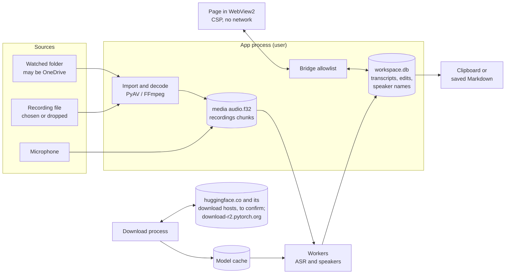

# Security model and threat assessment

This document describes how Unminute protects meeting recordings and transcripts: what it protects, from whom, the controls in place, the controls planned and the risks that remain. Its threat IDs are referenced by the security hardening slices in #111. Each slice updates this document when it lands.

It started from v0.4.3 (tag commit `579746f`). As each #111 slice merges, its controls move from "Planned" to "In place" (merged so far: A0, A1, A2, A3, A4, A5). A control described as planned names the #111 slice that delivers it and does not exist yet. Nothing here is a certification or legal advice. Privacy Act 2020 and other legal points are marked "to confirm" for a privacy adviser.

## Summary

- **Protected today.** Transcription runs on the laptop. Nothing is uploaded by the app. The page that shows meetings cannot load anything from the internet and can call only a fixed list of app functions. Model downloads are checked against published checksums. Deleted transcript text is overwritten inside the database file. The Hugging Face token is kept in Windows Credential Manager.
- **Not protected today, planned in #111.** Meeting audio and transcripts are stored unencrypted (protection rests on BitLocker). Exports are not recorded, and deletions leave only a content-free receipt for 30 days; there is no lasting audit trail. Releases are built by hand and not signed or attested. The install folder can be changed by anything running as the user. Untrusted recordings are decoded inside the main app process.
- **Depends on the firm's IT controls.** BitLocker, standard-user accounts, endpoint protection, a firewall rule for the app's runtime, and what staff do with a handoff after it leaves the app.

## Scope and assumptions

In scope: the Meeting Workspace app (`workspace/`, `asr_engines.py`, `offline_guard.py`), its private runtime and installer (`packaging/`, `tools/build_package.py`), and the build and release pipeline (`.github/workflows/`).

Out of scope: the earlier source-installed app (`transcribe_ui.py`, `transcriber_core.py`, the root `install.ps1`). It is not part of the package, is assumed not to be installed on managed laptops, and will be removed from the repository by #111 slice A7 (planned). Also out of scope: Windows itself, account and sign-in security, endpoint protection, and the tools staff paste a handoff into (for example an AI assistant). Those are the firm's controls; this document states where Unminute depends on them.

Assumptions for a managed deployment:

- Windows 11, managed by Intune, with BitLocker enabled and enforced by a compliance policy.
- Staff sign in as standard users, not local administrators.
- Microsoft Defender is active.
- WebView2 is the Evergreen runtime, kept up to date by Microsoft Edge Update unless IT has paused it.
- Each person uses their own Windows account; laptops are not shared under one account.

If BitLocker is not enforced, threat T6 is unmitigated until the planned encryption at rest (C1 to C3) ships.

## System overview

| Component | What it is | Runs as |
| --- | --- | --- |
| App process | `runtime\pythonw.exe -m workspace`. Owns the database, settings and the window, and decodes imported recordings. | The signed-in user |
| Window | A WebView2 control showing the bundled page `workspace/ui/index.html` from a `file://` URL. | WebView2 child processes (`msedgewebview2.exe`) |
| Bridge | The Python methods the page may call: an exact-name allowlist (`workspace/api.py` `API_METHODS`), enforced by a dispatch guard (`workspace/shell.py`). | Inside the app process |
| Inference worker | A `multiprocessing` child that loads one model at a time (`workspace/worker.py`). | The signed-in user |
| GPU companion worker | Optional, NVIDIA only. A second worker that puts the downloaded CUDA build of PyTorch first on its import path, for speaker identification (`workspace/gpu.py`). | The signed-in user |
| Download process | A short-lived child that downloads and verifies models and the optional GPU component on request (`workspace/setup.py`). It is the only Python process that runs without the network guard, by design. | The signed-in user |
| Workspace | `%LOCALAPPDATA%\whisper\workspace\`: `workspace.db` (SQLite, WAL), `media\<meeting id>\`, `recordings\<id>\`, `settings.json`, `templates.json`. | User's profile |
| Model cache | `%LOCALAPPDATA%\whisper-models\`, including the optional GPU component. | User's profile |
| Install | `%LOCALAPPDATA%\Programs\WhisperWorkspace\versions\<version>\` (per user). Planned (B6): per machine under `%ProgramFiles%\Unminute`. | User's profile |

Python processes talk to each other only through `multiprocessing` pipes created by the app. The page reaches Python only through WebView2's message channel, which pywebview uses for the bridge. At start, the app runs `nvidia-smi` once to detect an NVIDIA card.

The page is loaded from a `file://` URL, so pywebview does not start its local HTTP server (`workspace/shell.py`, header comment). The 13 October 2026 trial of the window shell, run from a source checkout, found no listening sockets (`docs/WEBVIEW_TRIAL.md`). This has not yet been re-checked on the packaged v0.4.3 build.

## Data flow

Meeting content leaves the app through the handoff Copy and Save buttons, and through ordinary text selection (Ctrl+C, or dragging selected text out of the window). Only the Copy button keeps its copy out of Windows clipboard history and cloud clipboard. The app also opens three fixed Hugging Face help pages in the browser, which carry no meeting content. Model downloads happen only when the user starts them.

## Trust boundaries

| ID | Boundary | Why it matters |
| --- | --- | --- |
| TB1 | Page to Python bridge | Page script can call any allowlisted method. If the page were ever compromised, the bridge is what it could reach. |
| TB2 | Recording file to decoder | Recordings may come from clients or shared folders. FFmpeg parses them with the user's full rights, inside the app process. |
| TB3 | App to network | Only model and component downloads should cross. Telemetry from dependencies must not. |
| TB4 | User-writable disk to app | Install, model, settings and workspace folders are writable by anything running as the user. |
| TB5 | Build and release to users | Whatever is published is installed on every laptop. |
| TB6 | App to clipboard and files | After content leaves the app, the app no longer controls it. |
| TB7 | User to other accounts on the device | Other users, administrators, SYSTEM services and management agents. |

## Assets

| ID | Asset | Sensitivity |
| --- | --- | --- |
| AS1 | Meeting audio (decoded audio, recording chunks) | Confidential client information |
| AS2 | Transcripts, edits, edit history, reviewed snapshots | Confidential client information |
| AS3 | Speaker names, meeting titles, hold reasons, redaction words, handoff templates | Personal and client information |
| AS4 | Original file paths, watched-folder paths | Identifying metadata |
| AS5 | Hugging Face access token | Credential |
| AS6 | App code and private runtime | Integrity: code runs with the user's rights and has microphone access |
| AS7 | Model files and the optional GPU component | Integrity: the speaker model format and the GPU component can run code when loaded |
| AS8 | Release artefacts and build pipeline | Integrity for every installation |
| AS9 | Evidence of handling (receipts; planned audit log, C5) | Accountability |

## Attacker and actor profiles

| ID | Profile | Example |
| --- | --- | --- |
| P1 | Author of a hostile media file | A crafted recording sent by email or dropped into a shared folder that is being watched |
| P2 | Script running in the page | Would need a rendering flaw; none is known (text-only rendering, strict CSP) |
| P3 | Malware running as the user | Any process the user starts |
| P4 | Thief of a lost or stolen laptop | Offline access to the disk |
| P5 | Other account, administrator or management agent | Another local user, IT support tools, backup agents |
| P6 | Repository insider or compromised maintainer account | Pushes code or replaces a release |
| P7 | Compromised dependency or download host | A malicious package version or tampered download |
| P8 | Network attacker | Intercepts or redirects download traffic |
| P9 | Staff member, by mistake or misuse | Copies a transcript somewhere unsuitable, records without telling people, keeps content too long |

## Threats and controls

"In place" is the state on `main` after the merged slices listed above (the Summary describes v0.4.3). "Planned" names the #111 slice. "Residual after planned controls" is what remains once the planned controls ship; until then, the risk today is described by the "In place" column.

| ID | Threat | Profile | In place | Planned | Residual after planned controls |
| --- | --- | --- | --- | --- | --- |
| T1 | Page script calls the bridge to read content or trigger actions | P2 | Strict CSP (`connect-src 'none'`, no remote scripts); page renders text with `textContent` only; exact-name bridge allowlist; navigation lock to the window's own page (`index.html`) only; DevTools off; downloads and new windows refused. Since A2: test engines (`test:module:function`) only when tests ask for them; drop events rebuilt so a page-supplied file path never survives; calls with the wrong arguments refused before they run; the app refuses to start unless the WebView2 renderer and the guard are in place, and closes the window if the lock cannot attach | A6: native Windows confirmation for recording, delete authority and discard | A compromised page could still read content through the bridge, put it on the clipboard and use the in-page cleanup confirmations |
| T2 | Hostile media file exploits the decoder to run code | P1 | Extension allowlist, 8 GB limit, regular files only. Since A3 each file is decoded by `workspace/decode_child.py` in a separate short-lived process: started as a plain process (no handle to the app), placed in a Windows job before it gets the file (`workspace/jobs.py`: 2 GB memory, no child processes, killed with the app, and no clipboard or desktop access unless the app already runs in a job with its own UI limits, when those apply instead), and required to lower itself to Low integrity, so Windows stops it writing the user's files or opening the app's process. It returns only checked binary audio frames (nothing is unpickled); the app writes and hashes the audio and enforces the limits. FFmpeg may use only the demuxers for the supported recording types (`decode_child.DEMUXERS`), whatever the content claims to be. Files in watched folders are decoded with no user action | None | A decoder exploit runs as the user at Low integrity: it can read what the user can read, and could try other routes Windows leaves to Low processes (for example some COM services); the runtime firewall rule (B7) stops it sending data out |
| T3 | Media file makes the decoder fetch network or local resources | P1 | Since A3: FFmpeg reads the file through a Python file object and may use only the local file protocol (`protocol_whitelist=file`); the network-capable demuxers in the bundled FFmpeg (HLS, DASH, RTSP, RTP, SDP) and the concat demuxer are excluded by the demuxer allowlist. The decode process also runs the Python network guard | B7: firewall block for the runtime | Low. A per-program firewall rule may not cover SMB or WebDAV connections Windows makes on the app's behalf (to confirm) |
| T4 | File decodes to an enormous length and fills the disk | P1 | 8 GB input limit. Since A3: decoding stops at 12 hours of audio and keeps 1 GB of disk free; the decode process is limited to 2 GB of memory | None | Low |
| T5 | Path tricks (UNC, device, junction, mapped drive) cause network access or deletion outside the intended folder | P1, P3 | `workspace/safe_paths.py` refuses raw UNC and device paths; cleanup checks links, deletion authority and the original's hash before deleting an original. Since A3, imports refuse mapped network drives before the path is resolved, refuse symbolic links found with `lstat` (which does not follow them), and re-check the resolved path; junctions, which can only point at local volumes, are followed and re-checked. Since A5 an organisation can allow mapped network drives and symbolic links for imports (`AllowNetworkSources`, off unless set); raw `\\server\share` paths and watched folders on network drives stay refused | None | Low. With the policy on, opening a recording on a mapped drive offers the file server the user's Windows credentials, as any app would |
| T6 | Offline access to the disk reads meetings | P4 | Relies on BitLocker (assumption) | C1 to C3: AES-256-GCM encryption of content with a DPAPI-protected key. IT: BitLocker compliance policy | Protected while the laptop is off or hibernated |
| T7 | Deleted content is recoverable from database free pages, the WAL, SSD remnants or temp files | P3, P4, P5 | `PRAGMA secure_delete=ON`; final cleanup truncates the WAL and runs VACUUM (`workspace/cleanup.py`). Media files are removed by ordinary deletion. Since A2: SQLite keeps temporary data in memory (`temp_store=MEMORY`), and the WebView2 profile is kept in `workspace\webview\` and wiped at the next start after a crash | C3: crypto-erase (each cleanup confirmation destroys that meeting's key) | Content written by v0.4.x before C3 may remain in free disk space, protected by BitLocker only |
| T8 | Another account, an administrator or a backup agent reads the workspace | P5 | Inherited `%LOCALAPPDATA%` permissions stop other standard users. Administrators, SYSTEM services and backup agents can read the workspace today | C1 to C3: content is unreadable without the user's DPAPI key | An administrator who runs code in the user's session can still read it |
| T9 | Malware running as the user reads content, records the microphone or tampers with the app | P3 | Windows shows its microphone-in-use indicator | B6: per-machine install that standard users cannot modify. A4 and B7: model integrity | Malware running as the user can read what the user can read. This relies on Defender and endpoint controls |
| T10 | Tampered model file runs code when loaded | P3, P7 | Every model file is pinned by revision and SHA-256 at download (`asr_engines.py`, `docs/MODEL_MANIFEST.md`). At load, files are checked by size and modification time against a marker kept in the same user-writable model cache. Since A4, the speaker model is fully re-hashed before every load (`engines.diarize_file`) | B7: read-only machine-wide models. B9: load weights without full unpickling | Low once B7 ships |
| T11 | Content or telemetry leaves over the network | P3, P7 | Offline guard on Python sockets in the app and workers (`offline_guard.py`); dependency telemetry switched off before import; page CSP `connect-src 'none'`; WebView2 started with a switch that resolves no host names (whether WebView2 honours it is not yet verified, see `docs/WEBVIEW_TRIAL.md`). Native libraries (FFmpeg, ONNX Runtime, CTranslate2, PyTorch, PortAudio) do not use Python sockets, so the guard does not cover them. Since A4 the guard also refuses UDP datagrams (`sendto`) and asyncio's Windows connect and send path (which bypassed `socket.connect`), and `--self-test` checks TCP, UDP and asyncio against 192.0.2.1 | B7: firewall block for the runtime | WebView2 child processes are shared with other apps and cannot be firewalled by path |
| T12 | Tampered or redirected download | P7, P8 | HTTPS, and SHA-256 check before files are moved into place. The GPU component's download is pinned to its host and refuses redirects elsewhere. Since A4 the download process checks the host of every HTTP request and redirect against an allowlist (`setup.DOWNLOAD_HOSTS`: huggingface.co, hf.co, download-r2.pytorch.org), which also holds behind a proxy, where this computer never looks up the target; it also runs the network guard with the same names plus the configured proxies (exact names), following only public addresses the download names resolve to (proxies may be on private addresses). Hugging Face's native Xet downloader is off; certificates are checked against the Windows certificate store (truststore) | None | Low. Proxies given only by PAC/WPAD scripts are not used; a Hugging Face mirror (`HF_ENDPOINT`) is refused; a network whose DNS answers public names with private addresses would block downloads |
| T13 | Hugging Face token is stolen | P3 | Stored in Windows Credential Manager; passed to the download process by pipe, never on a command line; errors from the download are replaced with fixed messages. Since A2, an `HF_TOKEN` variable set for the earlier app is moved out of the app's environment at start, so its child processes do not inherit it; it is still used by the "use the earlier token" option | A7: remove the earlier app's fallback. B7: models pre-staged by IT so staff need no token | Any process running as the user can read a generic credential |
| T14 | A tampered release reaches laptops | P6, P7 | Packages are built on the maintainer's computer, uploaded by hand and not code-signed. With `-Package` the installer checks the zip against a `.sha256` file that must sit beside it (normally downloaded from the same release page); from an extracted folder it checks only the manifest inside the package. Both detect corruption, not tampering by anyone who can replace the package and its checksum together | B1: hash-locked dependencies. B2: clean-tree, reproducible build with SBOM. B3: build in CI with signed provenance, published only after approval in a protected environment | The maintainer approves their own releases |
| T15 | Workflow injection or token misuse in CI | P6 | Since A1: no default permissions and least privilege per job; every action pinned to a commit SHA; checkouts keep no credentials; release runs only from a `vX.Y.Z` tag on a commit in `main`, with event values passed through environment variables; zizmor workflow lint and CodeQL for Actions on every pull request | Owner settings: a tag ruleset and a protected release environment (B3) | Low |
| T16 | Known vulnerability in a shipped dependency or the Python runtime | P7 | Dependabot security alerts; routine version updates cover the root requirements file only. Self-service installs have no update check | B1: pip-audit on every PR and daily, both requirement sets covered. B4: move to a Python version that still gets Windows binary releases | Time from disclosure to a fixed release, plus time until each laptop installs it |
| T17 | A handoff goes somewhere uncontrolled | P9 | Copy and save are explicit actions; the Copy button marks its copy so it is kept out of clipboard history and cloud clipboard (best effort: a failure to add the marks is ignored); handoff-only omissions and redactions; optional speaker-name replacement. Any app in the session, and remote-desktop clipboard redirection, can read the clipboard. Since A2 the suggested file name has the import date and time, never the title. Since A5 policy can clear the app's own copy from the clipboard after a set time and when the app closes, only if nothing else was copied since (`ClipboardClearMinutes`); set the Save dialog's starting folder (`HandoffDefaultFolder`); and allow the title in the suggested name (`HandoffFilenameIncludesTitle`, never when speaker names are replaced) | C5: copy and save recorded in the audit log | What staff do with a handoff after it leaves the app is a policy and training matter |
| T18 | A meeting is recorded without people knowing | P9, P2 | Microphone recording is off by default; a notice on the recording card; a recording stops itself after 8 hours. Page script can turn the microphone on and start recording without a Windows prompt. Since A5 an organisation can turn microphone recording off by policy (`AllowMicrophoneRecording`), which page script cannot override | A6: a native confirmation before every recording, stored with the meeting; a recording indicator in the title and taskbar | Legal position to confirm (Privacy Act IPP 3; Crimes Act provisions on interception) |
| T19 | Content is kept longer than needed | P9 | Two explicit cleanup confirmations; holds need a reason; held content is listed for review after 30 days while the app is open. Unreviewed meetings get no reminders | C6: reminders and an action-required state set by policy | Deletion stays a human decision by design (to confirm against IPP 9) |
| T20 | Nobody can show who exported or deleted what | P9, P6 | Content-free receipts kept for 30 days | C5: content-free, hash-chained audit log with a Windows Event Log mirror | The same user could rebuild the local chain; the Event Log copy is the stronger record |
| T21 | A crash dump captures content | P5 | The app writes no logs; WebView2 is started with `--disable-breakpad` (not yet verified that it is honoured) | IT: Windows Error Reporting local-dump setting for the runtime. C7: packaged checks report any new dumps | To confirm on a managed device |
| T22 | Installer weakens endpoint protections | P3, P6, P7 | None. The installer runs with execution policy Bypass, runs the new package's Python for the update check from outside the install folder (from `%TEMP%` with `-Package`, otherwise from the extracted folder), and removes the Mark of the Web from executable files after verifying them | B6: no execution policy bypass, no execution from `%TEMP%`, no Mark of the Web removal, admin-only install folder | Low |
| T23 | WebView2 is not detected and pywebview falls back to the old IE engine, losing the CSP and the navigation lock | P2 | The installer refuses to install when WebView2 is not registered. Since A2 the app also refuses to start, with a message, unless pywebview selected WebView2 | None | None expected |
| T24 | Code planted in the user-writable install, bytecode cache or GPU component | P3 | Manifest checked at install time only. The runtime writes `__pycache__` into the install folder. The GPU component is fully hashed once per app session, but its `__pycache__` folders are excluded from the check. Since A5 the GPU component can be switched off by policy (`AllowGpuComponent`) | B2: precompiled bytecode, no runtime bytecode writes. B6: admin-only install folder | Low once B6 ships |
| T25 | The optional GPU component (a 1.9 GB download, about 2.7 GB installed, mostly native CUDA and PyTorch libraries) is tampered with after download | P3, P7 | Pinned wheel hashes and per-file RECORD hashes, checked at download and once per session; it is loaded first on the GPU worker's import and DLL path. Since A5, `AllowGpuComponent=0` stops it being downloaded or used, and speaker identification runs on the processor | None | Low when disabled |
| T26 | An old, vulnerable version is kept or restored | P3, P9 | `install.ps1 -Rollback` returns to the retained previous version with no minimum-version check | B5 and B6: managed per-machine installs updated by Intune | Low on managed devices |
| T27 | Settings or templates are changed to weaken the app | P3 | Since A2, `settings.json` values pass the same checks when loaded as a change made in Settings, and invalid values fall back to their defaults; `templates.json` entries are checked for type only, not length or content | C2: templates sealed under the workspace key | Low |
| T28 | Deleting a watched original deletes it everywhere it syncs | P9 | Deletion authority is off unless granted per folder; the original's identity must still match. A deletion in a synced folder syncs to the cloud and to everyone the folder is shared with (to confirm with IT). Since A5, `AllowDeleteOriginals=0` refuses new authority and keeps originals even in folders where authority was given before | None | Policy decision for the firm |
| T29 | Content is left behind when a person leaves or a laptop is reassigned | P5 | Uninstall keeps the workspace, models and token by design. An interactive uninstall says the workspace and models were kept; it does not mention the token, and a silent uninstall says nothing | B8: offboarding report and removal | Low |
| T30 | Text in a transcript tries to steer the AI assistant it is pasted into (prompt injection) | P1, P9 | The handoff marks the transcript with content-derived markers and tells the assistant to treat it as data (`workspace/handoff.py`) | None | The assistant's behaviour is outside the app's control |
| T31 | The window is shown in a screen share or captured | P9 | None | None | User awareness; out of the app's control |

Cross-border points to confirm with a privacy adviser: pasting a handoff into an AI assistant hosted overseas may raise IPP 12 questions.

## Data inventory

| Data | Location (v0.4.3) | Protection today | Retention |
| --- | --- | --- | --- |
| Original recording | Wherever the user keeps it | None from the app | Never deleted, unless a watched folder grants deletion authority and the original's identity still matches |
| Original's path, size, modification time and SHA-256 | `workspace.db` (`sources`) | Inherited folder permissions | The path is kept only when deletion authority applies; the rest until final cleanup |
| Decoded audio `audio.f32` | `workspace\media\<meeting id>\` | Inherited folder permissions | Until the audio cleanup after review (or a discard) completes; longer while a hold applies or a cleanup has failed |
| `recording.json` (meeting title, microphone name, recording events) | `workspace\media\<meeting id>\` | Inherited folder permissions | With the decoded audio |
| Recording chunks, `recording.wav` and journal | `workspace\recordings\<id>\` | Inherited folder permissions | Removed after import; after a crash, kept until the user decides |
| Transcript, edits, history, snapshot, speaker names, redaction words, hold reasons, titles | `workspace.db` and its WAL | Inherited folder permissions; deleted rows are overwritten | Until final cleanup, then the WAL is truncated and the file is compacted |
| SQLite temporary data during VACUUM | Memory (since A2) | Not written to disk | Seconds |
| Receipts | `workspace.db` | Content-free | 30 days, purged while the app runs |
| Watched-folder paths, path hashes, content fingerprints | `workspace.db` | Paths in plain text; path hashes keyed with a key stored in the same database | Paths until the folder is removed; fingerprints 120 days |
| `settings.json`, `templates.json` | `workspace\` | Plain files | Until changed; templates may contain names |
| Hugging Face token | Windows Credential Manager | DPAPI (by Windows) | Until removed in Setup; kept by uninstall |
| WebView2 profile | `workspace\webview\<random>` (since A2) | Private (InPrivate) mode | Removed on a clean close; leftovers wiped at the next start |
| Clipboard copy | Windows session | Copy button: excluded from history and cloud sync | Until replaced |
| Saved handoff | Where the user saves it | None from the app | Not tracked |
| Models and GPU component | `%LOCALAPPDATA%\whisper-models\` | SHA-256 verified at download | Until removed in Setup; kept by uninstall |

Planned changes: C2 encrypts the content columns of `workspace.db` (titles, passages, edits and history, snapshots, speaker names, redaction words, hold reasons, source path, error text) and the watched-folder paths, and seals `templates.json`. C3 encrypts the decoded audio and recording chunks and removes `recording.json` and `recording.wav`.

## What the controls do not cover

- **Malware running as the user.** Today it can read the workspace files directly. After C1 to C3 it could still unlock them through the user's Windows key protection (DPAPI). Endpoint protection is the control for this.
- **Administrators.** Someone with administrator rights who runs code in the user's session can read what the user can read.
- **Content after it leaves the app.** Once text is on the clipboard or in a saved file, the firm's other controls apply.
- **The page file and hibernation file.** Windows may write memory to disk. BitLocker protects these.
- **Forensic erasure.** On SSDs, ordinary deletion does not guarantee the old blocks are erased. The planned crypto-erase (C3) makes leftover encrypted data unreadable instead.

## Reporting a vulnerability

See [SECURITY.md](../SECURITY.md).
