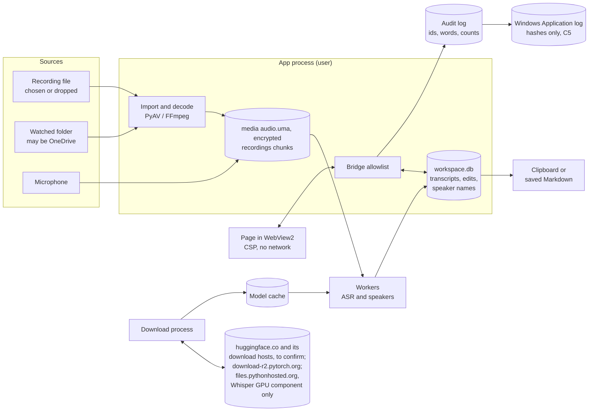

# Security model and threat assessment

This document describes how Unminute protects meeting recordings and transcripts: what it protects, from whom, the controls in place, the controls planned and the risks that remain. Its threat IDs are referenced by the security hardening slices in #111. Each slice updates this document when it lands, and the matching row of [CONTROL_MATRIX.md](CONTROL_MATRIX.md), which maps each threat to its guard tests and evidence (a test fails when the two disagree on threats or planned slices).

It started from v0.4.3 (tag commit `579746f`). As each #111 slice merges, its controls move from "Planned" to "In place" (merged so far: A0 to A7, B1 to B4, B7a, B7b, B8a, B8b, B9, C1, C2a, C2b-1, C2b-2, C2c, C3a, C3b, C3c, C4a, C4b, C5, C6, C7, D2's decoder limits, and #299's decoder container). A control described as planned names the #111 slice that delivers it and does not exist yet. Nothing here is a certification. It records what the software does and takes no position on any law; that assessment belongs to each organisation that deploys it.

## Summary

This describes `main` with #111 phase C complete (C7). Each item names its threat; "Threats and controls" has the detail and the residual risk.

- **Protected today.**
  - Transcription runs on the laptop, and the app uploads nothing (T10 to T12).
  - Meeting content is encrypted at rest: the database's content columns and the handoff templates are sealed, and each meeting's decoded audio and each microphone recording's chunks are encrypted, under keys wrapped by a root key that Windows Data Protection protects for this user (T6, [ENCRYPTION.md](ENCRYPTION.md)).
  - Cleanup destroys a meeting's keys (crypto-erase) and deletes its files, and deleted database text is overwritten in place, so a leftover copy cannot be opened once every copy of the wrapped key is gone (T7).
  - A workspace whose key Windows will not unlock opens locked, never in plain text (T6).
  - Imports, recordings, holds, handoffs and deletions are recorded in a content-free, hash-chained audit log, with a copy in the Windows Event Log (T20).
  - Untrusted recordings are decoded in a separate process, within format, size and length limits (T2 to T4). Since #299 that process runs in a Windows AppContainer with no capabilities, so a recording that takes it over cannot read the user's files or the workspace, or reach the network; if the container cannot be set up, the import is refused (T2, T3).
  - The page that shows meetings cannot load anything from the internet and can call only a fixed list of app functions; starting a recording needs a confirmation drawn outside the page (T1, T18).
  - Model downloads are checked against pinned checksums, and the Hugging Face token is kept in Windows Credential Manager (T10, T13).
  - Releases are built by CI from the tagged commit, with provenance and SBOM attestations, and published only with the owner's approval. Each release's packaged evidence shows no plain content left at rest or after cleanup in the app's data folder, its TEMP, and the APPDATA, user folder and rest of LOCALAPPDATA its checks redirect, and names every file a run adds to LocalLow or the model cache. Since #418 it first opens the marked meeting in the real window through the real start, so the window's WebView2 profile and the real start's own files are covered too; the next release's evidence is the first to show it (T14, T7).
  - A machine install's folder can be changed only by administrators, and its code is checked at install time (T24).
  - On a machine install, IT can turn on outbound Windows Firewall rules that block the app's runtime (`install.ps1 -Machine -BlockRuntimeNetwork`, B7b). They are off unless IT turns them on, they also block model downloads, so they suit computers where IT stages the models and turns downloads off by policy, and they do nothing where Windows Firewall ignores the computer's own rules. Elsewhere, including every per-user install, the offline guard covers only Python's own network calls, not native libraries or a decoder taken over by a hostile file (T2, T3, T11).
  - On a machine install, IT can install the models for everyone in that folder, from a package checked against a verified release; the app uses them first and never changes them, and policy can stop it using any copy a user could change, so staff need no Hugging Face token (T9, T10, T13).
- **Not protected today, planned.** None: since B7a and B7b, no threat row plans code work. A newly planned item names the work and the threats whose rows plan it; a test keeps this list equal to the rows' Planned column.
- **Not covered by design.** Malware running as the user can unlock the sealed content through the user's Windows key protection, as the app does (T9). A copy of the whole workspace taken before cleanup can still be opened by this Windows user (T7). Content is outside the app's control once it is copied or saved (T17). A per-user install and the GPU component stay writable by the user (T24).
- **Depends on the firm's IT controls.** BitLocker, standard-user accounts, endpoint protection, application control that stops per-user copies on managed computers (T24), managed per-machine installs updated by Intune, so an older version is not kept or restored (T26), turning on the runtime firewall rule on machine installs, with models staged and downloads off by policy, and letting Windows Firewall apply it (or deploying the same rules by Intune firewall policy) (T2, T3, T11), forwarding the Windows Event Log off the device, what staff do with a handoff after it leaves the app, and which tools (connectors) the assistant they hand off to can use.

## Scope and assumptions

In scope: Unminute (`workspace/`), its private runtime and installer (`packaging/`, `tools/build_package.py`), and the build and release pipeline (`.github/workflows/`).

Out of scope: Windows itself, account and sign-in security, endpoint protection, and the tools staff paste a handoff into (for example an AI assistant). Those are the firm's controls; this document states where Unminute depends on them.

Assumptions for a managed deployment:

- Windows 11, managed by Intune, with BitLocker enabled and enforced by a compliance policy.
- Staff sign in as standard users, not local administrators.
- Microsoft Defender is active.
- WebView2 is the Evergreen runtime, kept up to date by Microsoft Edge Update unless IT has paused it.
- Each person uses their own Windows account; laptops are not shared under one account.

If BitLocker is not enforced, meeting content is still encrypted at rest (T6, since #111 phase C), within the limits of Windows Data Protection ([ENCRYPTION.md](ENCRYPTION.md)); the page file, the hibernation file and anything outside the workspace are then unprotected.

## System overview

| Component | What it is | Runs as |
| --- | --- | --- |
| App process | `runtime\pythonw.exe -I -B -X disable-remote-debug -m workspace`. Owns the database, settings and the window. Since A3 it has each imported recording decoded by the decoder process. | The signed-in user |
| Decoder process | A short-lived child per import (`workspace/decode_child.py`, since A3), in a Windows job, that sends back only checked audio frames (T2 to T4). Since #299 it runs in a Windows AppContainer with no capabilities (`workspace/appcontainer.py`), with no access to the user's files or the network, and gets the recording as one read-only handle. | The signed-in user, in the AppContainer `Unminute.Decoder` at Low integrity |
| Window | A WebView2 control showing the bundled page `workspace/ui/index.html` from a `file://` URL. | WebView2 child processes (`msedgewebview2.exe`) |
| Bridge | The Python methods the page may call: an exact-name allowlist (`workspace/api.py` `API_METHODS`), enforced by a dispatch guard (`workspace/shell.py`); while the workspace is locked, only `LOCKED_METHODS` reach the `Workspace` (`make_api`'s gate, #111 C4a; AGENTS.md I3). | Inside the app process |
| Inference worker | A `multiprocessing` child that loads one model at a time (`workspace/worker.py`). | The signed-in user |
| GPU companion workers | Optional, NVIDIA only. Each loads one downloaded component and never the other's, because their CUDA libraries clash in one process (`workspace/gpu.py`): one puts the CUDA build of PyTorch first on its import path, for speaker identification; the other loads NVIDIA's cuBLAS for CUDA 12 by full path, for Whisper (#248). Only one runs at a time. | The signed-in user |
| Download process | A short-lived child that downloads and verifies models and the optional GPU components on request (`workspace/setup.py`). Since A4 it runs the network guard too, limited to `setup.DOWNLOAD_HOSTS` and the configured proxies; since #248 the process that downloads the Whisper GPU component may also reach files.pythonhosted.org (`setup.download_hosts`). | The signed-in user |
| Workspace | `%LOCALAPPDATA%\Unminute\workspace\`: `workspace.db` (SQLite, WAL), `media\<meeting id>\`, `recordings\<id>\`, `settings.json`, `templates.sealed` (since C2c; `templates.json` before), `download_queue.json` (since #366, while downloads are queued; written through `download_queue.tmp`). | User's profile |
| Model cache | `%LOCALAPPDATA%\Unminute\models\`, including the optional GPU components. | User's profile |
| Install | `%LOCALAPPDATA%\Programs\Unminute\versions\<version>\` (per user), or since B6b `%ProgramFiles%\Unminute\versions\<version>\` with the `current` junction (machine mode, run by IT as SYSTEM). | User's profile (per user); Program Files, changeable by administrators only (machine mode) |

Python processes talk to each other only through `multiprocessing` pipes created by the app. The page reaches Python only through WebView2's message channel, which pywebview uses for the bridge. At start, the app runs `nvidia-smi` once to detect an NVIDIA card.

The page is loaded from a `file://` URL, so pywebview does not start its local HTTP server (`workspace/shell.py`, header comment). The 13 October 2026 trial of the window shell, run from a source checkout, found no listening sockets (`docs/history/WEBVIEW_TRIAL.md`). This has not yet been re-checked on the packaged v0.4.3 build.

## Data flow

Meeting content leaves the app through the handoff Copy and Save buttons, and through ordinary text selection (Ctrl+C, or dragging selected text out of the window). Only the Copy buttons keep their copy out of Windows clipboard history and cloud clipboard. The app also opens a fixed set of help pages in the browser (three on Hugging Face and the user guide's recovery steps on GitHub, `setup.HELP_LINKS`), and, after a Copy and open click (#109), the Hand off assistant's fixed address (ChatGPT by default, or the one managed policy sets). None of these addresses carries meeting content, and the app process makes no connection for them: Windows hands the address to the default browser, and the user pastes and sends. On 20 Oct 2026 the owner accepted (DEC-012, DEC-013) the #109 design as recommended, including its reading that a browser launch the user starts, to a fixed address, is outside N2, as the help pages already were. Model downloads happen only when the user starts them.

## Trust boundaries

| ID | Boundary | Why it matters |
| --- | --- | --- |
| TB1 | Page to Python bridge | Page script can call any allowlisted method. If the page were ever compromised, the bridge is what it could reach. |
| TB2 | Recording file to decoder | Recordings may come from clients or shared folders. Since A3 FFmpeg parses them in the decoder process; since #299 that process runs in an AppContainer with no capabilities, which cannot read the user's files or the workspace or reach the network (T2, T3). From A3 to #299 it ran at Low integrity, which could still read what the user can read; before A3 FFmpeg parsed them inside the app process with the user's full rights. |
| TB3 | App to network | Only model and component downloads should cross. Telemetry from dependencies must not. |
| TB4 | User-writable disk to app | Install, model, settings and workspace folders are writable by anything running as the user. Since B6b a machine install's folder is not: only administrators can change it. |
| TB5 | Build and release to users | Whatever is published is installed on every laptop. |
| TB6 | App to clipboard and files | After content leaves the app, the app no longer controls it. |
| TB7 | User to other accounts on the device | Other users, administrators, SYSTEM services and management agents. |

## Assets

| ID | Asset | Sensitivity |
| --- | --- | --- |
| AS1 | Meeting audio (decoded audio, recording chunks) | Confidential client information |
| AS2 | Transcripts, edits, edit history, reviewed snapshots | Confidential client information |
| AS3 | Speaker names, meeting titles, hold reasons, redaction words, handoff templates | Personal and client information |
| AS4 | Original file paths, watched-folder paths | Identifying metadata |
| AS5 | Hugging Face access token | Credential |
| AS6 | App code and private runtime | Integrity: code runs with the user's rights and has microphone access |
| AS7 | Model files and the optional GPU component | Integrity: the speaker model format and the GPU component can run code when loaded |
| AS8 | Release artefacts and build pipeline | Integrity for every installation |
| AS9 | Evidence of handling (receipts; since C5 the audit log and its Event Log copy) | Accountability |

## Attacker and actor profiles

| ID | Profile | Example |
| --- | --- | --- |
| P1 | Author of a hostile media file | A crafted recording sent by email or dropped into a shared folder that is being watched |
| P2 | Script running in the page | Would need a rendering flaw; none is known (text-only rendering, strict CSP) |
| P3 | Malware running as the user | Any process the user starts |
| P4 | Thief of a lost or stolen laptop | Offline access to the disk |
| P5 | Other account, administrator or management agent | Another local user, IT support tools, backup agents |
| P6 | Repository insider or compromised maintainer account | Pushes code or replaces a release |
| P7 | Compromised dependency or download host | A malicious package version or tampered download |
| P8 | Network attacker | Intercepts or redirects download traffic |
| P9 | Staff member, by mistake or misuse | Copies a transcript somewhere unsuitable, records without telling people, keeps content too long |
| P10 | AI coding agent working in the repository | Claude Code or Codex running commands on a maintainer's laptop, where the live workspace is |

## Threats and controls

"In place" is the state on `main` after the merged slices listed above. "Planned" names the #111 slice. "Residual after planned controls" is what remains once the planned controls ship; until then, the risk today is described by the "In place" column.

| ID | Threat | Profile | In place | Planned | Residual after planned controls |
| --- | --- | --- | --- | --- | --- |
| T1 | Page script calls the bridge to read content or trigger actions | P2 | Strict CSP (`connect-src 'none'`, no remote scripts); page renders text with `textContent` only; exact-name bridge allowlist; navigation lock to the window's own page (`index.html`) only; DevTools off; downloads and new windows refused. Since A2: test engines (`test:module:function`) only when tests ask for them; drop events rebuilt so a page-supplied file path never survives; calls with the wrong arguments refused before they run; the app refuses to start unless the WebView2 renderer and the guard are in place, and closes the window if the lock cannot attach. Since A6, starting a recording, allowing the app to delete originals from a watched folder (the question names the folder, from the app's records) and discarding a meeting each need confirming in a window the app draws itself, in Unminute's style, outside the web page, so page script cannot answer it (`workspace/consent.py`, `shell.native_confirm`). It replaces the page's own dialogs for these actions: a statement must be ticked, the action button is enabled a second after the window appears or regains focus (restarted by any click, key press or tick meanwhile) and answers a mouse click on it, or Enter, Space or a screen reader's Invoke only once it has held the focus for a second (so keyboard and Narrator users can confirm, but a typed key cannot), Enter and Esc mean Cancel and no button has a keyboard shortcut, only one question is open at a time, the same question is not asked again for 3 seconds after a Cancel, and without a window nothing is confirmed. The app itself refuses a recording or a deletion grant without the confirmation. The page cannot show its own text in a native or browser message box either: pywebview's alert message is dropped before it reaches a Windows message box, and WebView2's own alert, confirm and prompt dialogs are off from before the first page loads (`shell.install_alert_guard`, checked at start-up). Every browser permission request (microphone, camera, notifications and the rest) and every screen-capture request is refused at once with no prompt or picker, so the page cannot record outside the confirmed path; if these refusals cannot be put in place (for example a WebView2 Runtime too old to report screen capture), no page loads and the window closes. Since D2 (#111, red-team part 2), meeting titles (from a rename or a file name) and speaker names drop invisible format characters (Unicode category Cf, such as a right-to-left override), so a title cannot disguise itself in the meeting list; the zero-width non-joiner and joiner (U+200C, U+200D) stay, because Persian and Indic spelling needs them and they do not reorder text; transcript edits keep them all. Since #104 slice 3, live draft text reaches the page only through `recording_draft(since)` (a whole number from 0 to 10,000,000, refused otherwise), as text and times, at most 200 phrases a call, shown with `textContent`, not selectable and not announced as it grows; `recording_status` carries the draft's state and counts only. Since #462 (the approach agreed in DEC-079, 28 Oct 2026), `switch_microphone(index, name)` switches a recording already confirmed and running to another microphone Windows lists (a whole number from 0 to 10,000 and a name of at most 120 characters, refused unless both match the list the app last gave the page and the microphone is still connected, and refused by managed policy, while locked or when nothing is recorded); it cannot start a recording or open a microphone otherwise, and while recording `microphone_devices` lists the microphones Windows has now, names for the page only. Since B5b, a version opened for an older workspace that an update is waiting to take over (machine mode's `compat`) refuses new imports, folder scans and recordings in the bridge (`api.FINISH_ONLY_REFUSED`, without calling the Workspace) and in the Workspace itself, whatever the page shows; no bridge method was added for it | None | A compromised page could still read content through the bridge, put it on the clipboard, and use the in-page confirmations that remain: the two cleanup confirmations, discarding a recording in progress, and deleting a recording left after a crash. Accepted by the owner DEC-070 (18 Oct 2026, #175): page script can still open a Windows file picker (`showOpenFilePicker`, `showSaveFilePicker`, `showDirectoryPicker`; the page writes the file-type description in the open and save pickers, and the suggested file name in the save picker), Windows' Open dialog through a file input after a click in the page, and the print preview (`window.print`), which offers Save as PDF. File read and write permission requests are refused, so a write outside the app may fail, but that is not verified: a file chosen in a save picker may come with write access already granted. A file the user picks in the open picker or a file input becomes readable by the page without a permission request; the CSP (`connect-src 'none'`) stops the page sending it over the network, though like other content it could reach the clipboard through the bridge. A drafted guard is kept on branch `std/175-print-pickers` (PR #211, closed unmerged). It could already open the fixed help pages in the browser without limit (`open_help`); since #109 it can also, through `copy_and_open_assistant`, copy the previewed handoff and open the Hand off assistant's address, at most once every 3 seconds. It cannot choose or add to that address (the app takes it from policy or its default, checked by `policy.valid_url`, and the method takes no address argument), the page itself still has no link, `window.open` or navigation (`tests/test_hardening.py`), and pasting and sending still need the user |
| T2 | Hostile media file exploits the decoder to run code | P1 | Extension allowlist, 8 GB limit, regular files only. Since A3 each file is decoded by `workspace/decode_child.py` in a separate short-lived process: started as a plain process (no handle to the app), placed in a Windows job before it gets the file (`workspace/jobs.py`: 2 GB memory, no child processes, killed with the app, and no clipboard or desktop access unless the app already runs in a job with its own UI limits, when those apply instead), and required to lower itself to Low integrity, so Windows stops it writing the user's files or opening the app's process. It returns only checked binary audio frames (nothing is unpickled); the app writes and hashes the audio and enforces the limits. FFmpeg may use only the demuxers for the supported recording types (`decode_child.DEMUXERS`), whatever the content claims to be. Since D2 (red team, part 2) FFmpeg may also use only the audio decoders those types carry (`decode_child.AUDIO_DECODERS`, passed as `codec_whitelist`), so opening a file no longer runs a video, image or subtitle decoder on a video track, cover art in an MP3 or FLAC, or a subtitle track while it probes the streams; an audio stream whose decoder is not listed, or for which FFmpeg has no decoder (where PyAV 17 crashed), is refused with a fixed message. Since the #180 re-lock the bundled PyAV (19.0.2, with FFmpeg 9.0.2) also raises an error itself for such a stream instead of crashing (PyAV-Org/PyAV#2344, fixed in PyAV 18.1.0; #310), so the check is a second layer. The list covers PCM, A-law and mu-law, IMA and Microsoft ADPCM, MP3, MP2, AAC, ALAC, FLAC, Opus, Vorbis, WMA, AC-3, E-AC-3 and AMR, and, by the owner's decision DEC-028 of 22 October 2026 (#302), the phone and VoIP speech decoders G.729, G.723.1, GSM (`gsm`, `gsm_ms`), iLBC and Speex; TrueSpeech and QDM2 stay refused. Files in watched folders are decoded with no user action. Since C3b a microphone recording reaches the same decoder over its stdin as one WAV, read by the `wav` demuxer already on the list with the same limits (the request line is checked; no demuxer was added), so no plain copy is written and the decoder is given no path for it. Since #299 (the owner's decision DEC-042 of 24 October 2026) the decoder runs in a Windows AppContainer with no capabilities (`workspace/appcontainer.py`): the app starts it suspended, puts it in its job, and checks its token from outside (this profile's container, no capabilities, Low integrity) before any of its code runs; after READY it checks Low integrity from outside again, and only then gives it the recording, as one read-only handle the app opened (the request names a handle, never a path). Windows then gives the decoder no access to the user's files, the workspace or the key blob in `workspace.db`, and no network. It reads only what ALL APPLICATION PACKAGES may read: the runtime and the app code (the per-user installer grants that on its `versions` folder; a machine install's folder has it in its own permissions, B6b), plus its pipes and the recording's handle. The container's per-user profile `Unminute.Decoder` (a K1 name since the owner's approval DEC-048 of 25 October 2026) is made by the app when it first decodes and removed by the per-user uninstaller and by `--offboard`; the machine uninstaller never touches a user's profile, so after a machine uninstall it stays until that person is offboarded or their Windows profile is deleted. If any step fails (the profile, the start, the job, the token check, or the decoder not reaching READY), the import is refused with a message pointing IT to the fix and an incident code whose log record names only the step and the Windows error number; no decoder outside the container is ever started (the owner's decision DEC-042). A watched-folder recording refused this way is marked failed like any refused import, and the user imports it again once IT has fixed the container (the owner's decision DEC-048 of 25 October 2026). `tests/test_intake_isolation.py` starts a probe exactly as the decoder is started against a scratch workspace laid out like the real one: it reads its own recording and nothing else (the workspace, the models, a recording of the user's outside `Unminute`), cannot unprotect the workspace key and cannot open a loopback connection. Run on `main` before #299, the same probe read every file, unprotected the key and reached a loopback listener. Since B7b, on a machine install IT can also add an outbound Windows Firewall block for the runtime the decoder runs (T11) | IT: turn on the runtime firewall rule on machine installs | A decoder exploit runs in the container, at Low integrity, in its job. It can still read what ALL APPLICATION PACKAGES may read on the computer (the runtime and app code, Windows' own files, Program Files, and any folder IT or another program has opened to app packages); read the user's registry hive (measured in the #299 spike: it listed `HKCU\Software`); write in its own container folder (`%LOCALAPPDATA%\Packages\unminute.decoder`, kept until uninstall or `--offboard` removes the profile; nothing the app runs reads it); and unprotect a DPAPI blob that is handed to it (none is). It could try a flaw in Windows itself to leave the sandbox. AppContainer isolation gives internet, private network and server access only through capabilities, and this container has none: loopback was measured blocked, the internet was not tested (nothing was sent off the computer; to confirm on a managed laptop, #189). After a rollback to a version from before #299, that version's decoder runs at Low integrity with the earlier residual (it can read the workspace and the key blob, and reach the network) until a #299 version is installed again; the owner accepted (DEC-048) this (25 October 2026: no one rolls back). FFmpeg's stream parsers (for example the H.264 parser) still run on every stream while probing |
| T3 | Media file makes the decoder fetch network or local resources | P1 | Since A3: FFmpeg reads the file through a Python file object and may use only the local file protocol (`protocol_whitelist=file`); the network-capable demuxers in the bundled FFmpeg (HLS, DASH, RTSP, RTP, SDP) and the concat demuxer are excluded by the demuxer allowlist. The decode process also runs the Python network guard. Since #299 it runs in an AppContainer with no capabilities, which Windows gives no network access (internet, private network and loopback; loopback measured blocked by `tests/test_intake_isolation.py`), and which cannot open local files by path: FFmpeg gets only the recording's handle. Since B7b, on a machine install IT can also add an outbound Windows Firewall block for the runtime (T11) | IT: turn on the runtime firewall rule on machine installs | Low. The internet block is AppContainer's documented behaviour, not tested here (to confirm on a managed laptop, #189). A version from before #299, after a rollback, has the earlier decoder (accepted by the owner DEC-048, 25 October 2026). The runtime firewall rule, where IT turns it on, may not cover SMB or WebDAV connections Windows makes on the app's behalf (to confirm) |
| T4 | File decodes to an enormous length and fills the disk | P1 | 8 GB input limit. Since A3: decoding stops at 12 hours of audio and keeps 1 GB of disk free; the decode process is limited to 2 GB of memory. Since D2 (red team, part 2, finding 3: an 86 KB WAV whose header claimed 1 Hz decoded to 11.9 hours, 2.56 GiB): input sample rates outside 4 kHz to 384 kHz are refused, and a file may decode to at most one second of audio per 16 bytes of its size (`decode_child.BYTES_PER_DECODED_S`, 128 bit/s on average; the densest real encoder output measured, AAC digital silence at 8 kHz, is about 64 bytes a second), checked in the decoder and again in the app | None | Low. A crafted file can still decode to about 4,000 times its size (one second, 64 KB of decoded audio, per 16 bytes), up to the 12-hour cap, and a watched folder can queue many such files; the 1 GB disk reserve still holds |
| T5 | Path tricks (UNC, device, junction, mapped drive) cause network access or deletion outside the intended folder | P1, P3 | `workspace/safe_paths.py` refuses raw UNC and device paths; cleanup checks links, deletion authority and the original's hash before deleting an original. Installing, repairing or removing a model or the graphics card component refuses a link or junction at its folders inside the model cache before anything is written or deleted, and a model check neither trusts nor writes a check record through a link at the model, record or family folder, so such a copy is hashed in full each time (since R12a). Since A3, imports refuse mapped network drives before the path is resolved, refuse symbolic links found with `lstat` (which does not follow them), and re-check the resolved path; junctions, which can only point at local volumes, are followed and re-checked. Since A5 an organisation can allow mapped network drives and symbolic links for imports (`AllowNetworkSources`, off unless set); raw `\\server\share` paths and watched folders on network drives stay refused. Since R13b (#136) the installer and the uninstaller refuse an install folder that is empty, starts with `\\` or `//`, or is, holds or sits inside `%LOCALAPPDATA%\Unminute`. The uninstaller also refuses a folder that is neither an install (`current.json` or `versions`) nor the one its uninstall entry names, and keeps the shortcut and uninstall entry when that entry names another folder that still holds an install, so a wrong or older `-InstallDir` cannot remove the real install's shortcut and uninstall entry, and it removes only the installer's own entries (`versions`, `current.json`, `uninstall.ps1`), removing nothing if the folder holds anything else or a link or junction at those entries, and removes them with the installer's walk, which never follows a link inside them (#297). An install folder that reaches the workspace or models through a junction, a mapped letter or `subst` therefore cannot take them with it. Since #297 the installer, too, writes and removes only inside a folder that is new, empty, an install (a `current.json` object that names a plain version and, if it gives one, its own version folder's path) or holds only what an interrupted first install leaves, and refuses a link or junction at its own entries or directly inside `versions` (exit 2, before anything is written); it removes only version folders it made (a plain version name and a `version.json` naming it), never through a link, and leaves anything else in `versions`; and it checks the package's version and `current.json`'s values against the uninstaller's version-name pattern (ending in `\z`, so no final newline, and no final dot) before using them as folder names, so neither can lead outside `versions`. The app refuses to open its workspace when the real location of `%LOCALAPPDATA%` is inside OneDrive or on a network drive, and since #219 also when a junction or link takes `%LOCALAPPDATA%\Unminute` or its `workspace` folder there (D3), with a message that names IT and no folder; only `Unminute\models` may be redirected. Since #266 either folder being a junction or link whose target cannot be reached is refused too, with its own path-free message naming IT, so a chain of links, or a volume GUID or `\\?\` spelling, that hides a missing OneDrive target is still refused and nothing is created there. Since D2 (#111, red-team part 2), a watched folder may not be any folder that holds the user profile (such as `C:\Users`), `AppData` or any folder inside it (such as `Temp`, other apps' data and the old `%LOCALAPPDATA%\whisper` data folder, which keeps real content), any folder inside a redirected `%APPDATA%` or `%LOCALAPPDATA%`, or a folder that holds or sits inside `%LOCALAPPDATA%\Unminute` (`intake._broad`); before, only a drive root, the profile itself and the Windows and program folders were refused. Each scan checks a watched folder again, so one added before it was refused is not read while it is refused (its note gives the fixed message). A path inside a watched folder that Windows cannot open because it is too long (long paths off) no longer leaves the folder's first check incomplete, which had stopped all imports from it: the walk lists such a folder by its extended form (`\\?\`, only below the folder's own resolved, checked path) and reads only file sizes and times there; those recordings are counted in the folder's note and never imported. Since B5b (B5-4) the current version removes graphics card component copies in the model cache that no installed version names (`gpu.remove_superseded`, `Workspace.remove_unused_gpu`): only folders directly in `<model cache>\gpu` with a name the app makes, never a link (a link at `gpu` itself removes nothing), each renamed aside and then deleted without following any link inside it; nothing is removed when any installed version names none, when the other install mode is registered for the user or Windows cannot say, or while a download, check, removal or graphics card run is going on | None | Low. With the policy on, opening a recording on a mapped drive offers the file server the user's Windows credentials, as any app would. The D3 location check (#219) covers `%LOCALAPPDATA%`, `Unminute` and `Unminute\workspace` only: a junction or link at a folder inside the workspace (such as `workspace\media`) is not checked, nor is a redirect made while the app runs, since the check runs when the app or a command-line check starts. OneDrive is detected only as the folders the `OneDrive`, `OneDriveCommercial` and `OneDriveConsumer` variables name, so a library the OneDrive client syncs outside them, or another sync client's folder, is not detected. Each needs a deliberate redirect by someone who can write to the user's profile. The update gate's own path check (`update._local()`, #213) reads the path as text: a junction below a local workspace path that points to a share would be followed by `os.stat` and SQLite, which also needs write access to the user's own profile |
| T6 | Offline access to the disk reads meetings | P4 | Relies on BitLocker (assumption). Since C2b-2: the content columns of `workspace.db` (titles, notes, passages, word timings, edits and history, snapshots, speaker names, redaction words, hold reasons, source and watched-folder paths, the intake salt) are sealed with AES-256-GCM under per-meeting keys wrapped by a root key that Windows Data Protection protects for this user, and plain hashes of recordings are HMAC fingerprints ([ENCRYPTION.md](ENCRYPTION.md), "Database"). Since C2c the handoff templates are sealed under the workspace key (`templates.sealed`; a plain `templates.json` from an earlier version is converted at first use and deleted). Since C3a each meeting's decoded audio is encrypted (`media\<id>\audio.uma`, AES-256-GCM per block under a per-file key derived from the meeting's audio key; [ENCRYPTION.md](ENCRYPTION.md), "Audio files"), and no plain copy of it is written. Since C3b each microphone recording's chunks are encrypted under a per-recording key kept wrapped in the database (`recording_keys`), the recording reaches the decoder over its stdin with no plain `recording.wav`, and its details and consent record are sealed in `recording_sources` instead of a plain `recording.json` ([ENCRYPTION.md](ENCRYPTION.md), "A microphone recording"); the recorder's journal stays plain and holds no audio or words. Since C4a a key Windows will not unlock opens the workspace locked: nothing is opened or written, work waits, the page can call only a fixed few bridge methods, and the state is kept content-free for `--status` and `--health` (`logs\keys.json`); it never falls back to plain text ([ENCRYPTION.md](ENCRYPTION.md), "Locked"). Since C4b the page then shows only its locked screen: fixed wording and codes, no list or meeting asked for, no polling | IT: BitLocker compliance policy | Protected while the laptop is off or hibernated, within DPAPI's limits (roaming profiles, domain backup keys, the user's password: [ENCRYPTION.md](ENCRYPTION.md)) |
| T7 | Deleted content is recoverable from database free pages, the WAL, SSD remnants or temp files | P3, P4, P5 | `PRAGMA secure_delete=ON`; final cleanup truncates the WAL and runs VACUUM (`workspace/cleanup.py`). On a damaged database VACUUM cannot run: the rows are already overwritten by secure_delete, the WAL is confirmed checkpointed and truncated, and VACUUM is deferred to the next start whose database check passes (`compact.pending`, #198); otherwise the job retries. Media files are removed by ordinary deletion. Since A2: SQLite keeps temporary data in memory (`temp_store=MEMORY`), and the WebView2 profile is kept in `workspace\webview\` and wiped at the next start after a crash. Since C2b-2: a meeting's keys are destroyed in the cleanup transactions (the audio key at audio cleanup, the text key with the transcript), so a leftover copy of its sealed text cannot be opened once every copy of the wrapped key is gone; row ids never come back. Since C3a: each meeting's decoded audio (`media\<id>\audio.uma`) is encrypted under its audio key, which audio cleanup destroys in the transaction that records the audio removed, so a leftover copy of the decoded audio cannot be opened once every copy of the wrapped key is gone. Since C3b a recording's key is deleted in the transaction that sets up its meeting's first version (kept until then, so that step can be tried again), or before a discard, a delete or the removal of a folder already made into a meeting removes any of its files, and the WAL is then emptied (`compact.pending` if a reader keeps it busy), so chunks left on disk or in freed clusters cannot be opened; a key whose folder is gone, or whose recording is already a meeting, is deleted at the next sound start. Since C3c audio cleanup crypto-erases first: one transaction re-checks the audio holds, destroys the audio key and records the audio removed, then the WAL is checkpointed and truncated (`Store.erase_checkpoint`, retried while a reader keeps it busy; still busy, the job fails with a fixed note and deletes nothing), and only then are the folder and the originals deleted, so a crash or a file that cannot be deleted part way leaves nothing readable; a failed or abandoned import empties the WAL after destroying its keys (`compact.pending` if busy); never while locked ([ENCRYPTION.md](ENCRYPTION.md), "Crypto-erase at cleanup"). Since C7 each release's packaged checks show this on the package itself (`tools/packaged_check.py`, `tools/packaged_crash_check.py`, with `tools/residue.py`): after audio cleanup the audio key no longer opens while the text key does and the media folder is gone; after final cleanup nothing blocks an update, the database has no free pages and an empty write-ahead log, only the workspace's own files remain, and none of the marker text, windows of the decoded audio or the synthetic recording's audio is found anywhere in the profile, its TEMP or the APPDATA and user folder the checks redirect for their children, by a scanner that must first find each of them in a planted control file and that reports a folder it cannot list. Every file left in those redirected folders is named and fails the report unless `residue.EXPLAINED` names it, and every file a run adds to or changes in the real LocalLow and the model cache is named (names, sizes and times only, never opened) and must be one it names (the owner's decision DEC-058, 26 Oct 2026). Since #418, `tools/packaged_check.py` first opens the marked meeting in the real window, started as the Start menu shortcut starts it, shows its transcript through UI Automation without playing anything (the player must be found showing Play) and closes the window as a person does, before the at-rest scan. The model cache is lent to that start in the throwaway profile's models folder (large files hard-linked, small ones copied; a models folder already there stops the step before the app starts, so one the check did not make is never lent into or removed), so it opens on the meeting rather than Setup, and taken back when it closes; any file it added there must be one `residue.EXPLAINED` names. The WebView2 profile (`workspace\webview`), whose files a normal close deletes (private mode), is scanned with whatever the close left there, which the report counts and then removes as the app's next start does (`shell.storage_folder`), so a profile file still there after final cleanup fails "only the workspace's own files"; the workspace lock (`instance.lock`) and the launcher's record (`logs\launch.json`) must be new from that start and pass that list; and anything else a run leaves in the redirected LOCALAPPDATA outside the app's folder is scanned and named, failing unless `residue.EXPLAINED` names it. That no copy of a wrapped key's bytes is left is shown by unit tests (`tests/test_cleanup.py`), not the packaged checks | None | Content written by earlier versions before C2b-2, C3a and C3b (meeting text, decoded audio and a microphone recording's chunks) may remain in free disk space, protected by BitLocker only; old physical copies of a destroyed wrapped key can survive on an SSD, protected by BitLocker while the laptop is off; a whole-workspace copy taken before cleanup can still be opened by this Windows user. A normal close deletes the WebView2 profile by ordinary deletion, not a secure one, so anything WebView2 wrote there while a meeting was shown can remain in free disk space, protected by BitLocker only: the window step shows the profile free of content after the close, not while the window is open. The idle window of `tools/packaged_check.py` (its step 6) runs after the last scan and the LocalLow and model-cache comparison, so what it writes there or in the redirected folders is not compared. Both windows are started as the app is, so they write their own content-free Event Log entries and the window is tested exactly as shipped: the idle window by the owner's decision DEC-056 (26 Oct 2026), and the window step as #418's criterion allows (either no entry is written, or the report names how many were and why); the report counts the entries written for its throwaway workspace, with why (#418). Writes a dependency makes to the real Roaming or user folder through Windows' known-folder lookup, rather than the redirected variables, are not seen: the real Roaming folder is not listed, because other programs' recent-file shortcuts there can name documents (P3) |
| T8 | Another account, an administrator or a backup agent reads the workspace | P5 | Inherited `%LOCALAPPDATA%` permissions stop other standard users. Since C2b-2 the database's content columns, since C2c the handoff templates, since C3a the decoded meeting audio and since C3b the chunks of microphone recordings waiting to be imported (`recordings\`), are unreadable without the user's DPAPI key ([ENCRYPTION.md](ENCRYPTION.md)); a recording's plain journal shows its times, events and device names (a documented limit the owner accepted (DEC-030), 22 Oct 2026) | None | An administrator who runs code in the user's session, or holds the domain's DPAPI backup key, can still read it |
| T9 | Malware running as the user reads content, records the microphone or tampers with the app | P3 | Windows shows its microphone-in-use indicator. Since B4 the app (its Start menu shortcut and repointed pins), the installer's workspace check and the decode process start with `-X disable-remote-debug`, and the workers inherit it: Python 3.14's debugger interface (PEP 768, `sys.remote_exec`) would otherwise let a process with PROCESS_VM_READ and PROCESS_VM_WRITE rights on the app, "which typically require the same user context or appropriate privileges" (PEP 768), run code in it at its next safe point. The option is used rather than the `PYTHON_DISABLE_REMOTE_DEBUG` variable, which `-I` (used by the decode process) ignores, and which nothing sets. Since B6b a machine install keeps the app's code in `%ProgramFiles%\Unminute`, which standard users cannot change (T24). Since B7a it can also use models IT installed there, which the user cannot change (T10) | None | Malware running as the user can read what the user can read, and can inject code into the app's processes by other means. This relies on Defender and endpoint controls |
| T10 | Tampered model file runs code when loaded | P3, P7 | Every model file is pinned by revision and SHA-256 at download (`workspace/asr_engines.py`, `docs/MODEL_MANIFEST.md`). At load, files are checked by size and modification time against a marker kept in the same user-writable model cache. Since A4, the speaker model is fully re-hashed before every load (`engines.diarize_file`). Since B9 (#218), each speaker model file is read once, and its SHA-256 is taken over the bytes in memory; the pipeline is built from those same bytes, so no file is opened again after its check (pyannote's own loader reopened each checkpoint twice by path and unpickled it in full). Each checkpoint's pickle must name only allowlisted globals, by no other import route, before torch sees it. That check reads the archive with Python's zip reader, so the archive must have one reading for torch's reader too: nothing before its first entry or after its end record, zip64 end records only where torch.save writes them and agreeing with the end record, and entry names torch's reader cannot resolve to a different entry (printable ASCII, no backslash, one root, no two differing only in letter case). The pickle is then unpickled with `torch.load(weights_only=True)` and only three pyannote classes allowed (`Problem`, `Resolution`, `Specifications`), for that call only (`safe_globals`). That unpickler can call an allowed Enum, which gives the module's own member, and set attributes on it, or its class (BUILD applies slot state with `setattr`), so each unpickling (the check's and Lightning's) compares every `Problem` and `Resolution` member's class and attributes before and after, puts a changed member back and refuses the model. The pipeline and model classes are fixed in code, not named by a file, and the config, checkpoint metadata, hyperparameters, specifications and PLDA arrays must be exactly the pinned revision's (`workspace/speaker_load.py`); PLDA arrays are read with `allow_pickle=False`. A failed check or load gives one fixed message, and the worker log keeps only the cause's type name and frames; the libraries are imported before the checks, so an import failure (such as a CUDA library in the GPU worker) or running out of memory keeps its own error and the GPU fallback still applies. The workers also set `TORCH_FORCE_WEIGHTS_ONLY_LOAD=1`, so any other `torch.load` there is weights-only too, and `--self-test` checks that a synthetic code-running checkpoint, and ones that change an Enum member's attributes or its class, are refused and the member put back. Since B7a, a machine install that passes the machine trust test (B6b) uses a copy IT installed in `%ProgramFiles%\Unminute\models\<family>\<folder>\<revision>`, which only administrators can change, before any copy in the user's cache. That copy is trusted only through `models.verified.json`, the record IT's script writes beside it (this repository, revision and folder, and every file's size and modification time), or else hashed in full at each load; the app never writes there, never reads a record from the user's cache for it, and refuses it if a link is anywhere in it (`asr_engines.check_machine`). With `AllowUserModels` at 0, or a policy key it cannot read, a machine install uses no model from the user's cache (older Hugging Face cache copies included) and refuses model downloads. IT builds those copies with `tools/intune/New-ModelPackage.ps1` only from a release zip whose SHA-256 IT gives (from `Get-VerifiedRelease.ps1`) and that is a release build, takes the model list from inside that zip, and copies only the listed files, by exact name, after checking their sizes and SHA-256; `packaging/models/Install-Models.ps1`, run as SYSTEM, checks every file again, under the installer's lock and permission checks, and, for a revision an installed version pins, that the package lists exactly that version's files, sizes and SHA-256 (its `model-manifest.json`, #451), before it writes each record. IT's copy that fails a full check (Check every file, or a check after it failed to load) is kept as failed in that process's memory until its files change (`asr_engines._machine_failed`): no record is written for it, in the install folder or the user's cache. A worker then tries the next copy (the user's own, where allowed) and otherwise says to ask IT; the window learns of a worker's finding from its message, so Downloads shows the copy as damaged, with IT's wording, not as installed by IT | None | Low once B7 ships. The SHA-256 pins stay the main control: the allowlist runs no code, but a crafted pickle can still build objects of the three allowed classes. A new `Specifications` is checked field by field against the pinned values, and a change to a shared `Problem` or `Resolution` member is undone and refused; this relies on the pickle check, which limits a checkpoint to seven globals of which only the Enums give back shared objects (the others make new ones, and torch's unpickler cannot build onto a class itself). The pre-check reads the archive with Python's zip reader, not torch's: the layout and entry-name differences known are refused, but other differences between the two readers are not ruled out, so torch's scoped weights-only unpickler and the exact checks are what enforce on the pickle torch actually reads. Code planted in the install or its packages (T24) is not covered. A per-user install, and a machine install that allows user models where IT has installed no copy, still loads models from the user-writable cache; a version kept for an earlier storage format that is older than B7a ignores `AllowUserModels` until IT removes it. A machine copy whose files no longer match IT's record is hashed in full at every load (slower, still checked), since the app keeps no record of its own there. A machine copy changed with each file's size and modification time kept still passes on IT's record; it is found only by Check every file or when it fails to load, and that finding lasts until the app or the worker restarts (#451). An install whose `current.json` claims machine mode but that fails the machine trust test (B6b), or whose test cannot be completed, has no machine root: IT's copies are not used and `AllowUserModels` is not applied, so it behaves as a per-user install (a refused claim is logged as `machine_claim_refused`, with no path or name). IT's own computer, where the package is built, is trusted up to that build: the files are checked against the verified release's pins, not fetched again. At install, the package is checked against its own `models.json`, both from Intune's content folder, so whoever can write there could replace them together before the run, as for the app's package (T22) |
| T11 | Content or telemetry leaves over the network | P3, P7 | Offline guard on Python sockets in the app and workers (`workspace/offline_guard.py`); dependency telemetry switched off before import; page CSP `connect-src 'none'`; WebView2 started with a switch that resolves no host names (whether WebView2 honours it is not yet verified, see `docs/history/WEBVIEW_TRIAL.md`). Native libraries (FFmpeg, ONNX Runtime, CTranslate2, PyTorch, PortAudio) do not use Python sockets, so the guard does not cover them. Since A4 the guard also refuses UDP datagrams (`sendto`) and asyncio's Windows connect and send path (which bypassed `socket.connect`), and `--self-test` checks TCP, UDP and asyncio against 192.0.2.1. Since A7 nothing lets a download through in the app's own processes: the old `permit()`, which turned the guard off for the whole process, is removed (`uninstall()` remains for tests only). Since B7b (the owner's decision DEC-068 of 21 October 2026), IT can add an operating-system block beneath the guard on a machine install: `install.ps1 -Machine -BlockRuntimeNetwork` adds two outbound Windows Firewall block rules for each installed version, for its `runtime\python.exe` and `runtime\pythonw.exe` by the version folder's real path, in the group `Unminute runtime`, in the computer's own rules. The app, its workers, the decode process and the download process all run one of the two. The choice is kept in `current.json`, so later installs, rollbacks and removals keep the rules in step with the installed versions; a new version's rules are added before it becomes current (a failure stops the install, exit code 1), and the machine uninstall removes the group. It is off unless IT turns it on, and machine installs only. Because it also blocks downloads, the installer warns unless `AllowModelDownloads` is 0 (which refuses every download) or both `AllowUserModels` and `AllowGpuComponent` are, and when Windows Firewall is off or ignores the computer's own rules for a network profile (`AllowLocalFirewallRules`, read from the active store), where the rules have no effect | IT: turn on the runtime firewall rule on machine installs | Without the firewall rule (every per-user install, and machine installs where IT has not turned it on), only the Python guard applies, and native libraries are not covered. With it: WebView2 child processes are shared with other apps and cannot be firewalled by path; the rules block only the app's runtime programs, so an app process outside the decoder's container, if taken over, could still start Windows' own `curl.exe` or PowerShell, or have the Background Intelligent Transfer Service (BITS) download; a third-party firewall that replaces Windows Firewall, loopback traffic, and SMB or WebDAV connections Windows makes on the app's behalf are not covered (to confirm); a hardened firewall baseline that turns off local rule merging makes the rules do nothing (the installer warns; IT can deploy the same rules by Intune firewall policy, [IT_DEPLOYMENT.md](IT_DEPLOYMENT.md)); whether a rule for the version folder's path matches a process started through the `current` junction, and that the rule blocks an outbound attempt while the app still works offline, are to confirm on a managed laptop (#189). Older kept versions installed before B7b get rules too, as they are installed versions |
| T12 | Tampered or redirected download | P7, P8 | HTTPS, and SHA-256 check before files are moved into place. Each GPU component's download is pinned to its own HTTPS location and refuses redirects elsewhere. Since A4 the download process checks the host of every HTTP request and redirect against an allowlist (`setup.DOWNLOAD_HOSTS`: huggingface.co, hf.co, download-r2.pytorch.org; since #248, files.pythonhosted.org is added only in the process that downloads the Whisper GPU component, `setup.download_hosts`, as the owner authorised on 20 October 2026), which also holds behind a proxy, where this computer never looks up the target; it also runs the network guard with the same names plus the configured proxies (exact names), following only public addresses the download names resolve to (proxies may be on private addresses). Since A7, `workspace/asr_engines.py` has no downloader of its own and never reads a token from the environment: every download goes through the download process. Hugging Face's native Xet downloader is off; certificates are checked against the Windows certificate store (truststore). Since D2 (#111, red-team part 2) the request check also requires the standard HTTPS port (443), and a GPU component's address and every redirect are compared with its pinned location by scheme, host, port and percent-decoded path, refusing a user name, a `.` or `..` segment or a backslash (a plain string comparison let `<location>/../../x` through). Since #366, downloads the user queues run one after another, each in its own download process with the same checks: no new process, host or path. The queue is kept in `download_queue.json` (model names only) and carries on at the next start, as the owner decided (DEC-049) on 25 October 2026; only names `setup.known()` accepts are taken, and each is checked against the app's current managed policy just before it starts (K3; the cached policy, read again every 15 minutes or on each refresh while Settings or Downloads is open, the same freshness as a click) | None | Low. Proxies given only by PAC/WPAD scripts are not used; code running as the user can add a pinned model to `download_queue.json`, and it downloads at the next start without a click (the same pinned files, hosts and checks as a click, with the remembered token for the speaker model; until it ends, processing and live drafts wait, and its row says "Carried on from the last time Unminute was open."; such code can already do as much, T9); a Hugging Face mirror (`HF_ENDPOINT`) is refused; a network whose DNS answers public names with private addresses would block downloads |
| T13 | Hugging Face token is stolen | P3 | Stored in Windows Credential Manager; passed to the download process by pipe, never on a command line; errors from the download are replaced with fixed messages. Since A2, an `HF_TOKEN` variable in the user's environment is removed from the app's environment at start, so its child processes do not inherit it. Since A7 it is never used: the option to use a token from the environment is gone (`credentials.drop_environment_token`). Since #366 a token typed for a queued speaker model waits in the app process's memory until its turn and is never written to the queue file; after a restart only the remembered one is used. Since B7a, on a machine install IT can install every model, the gated speaker model included, from a package built with IT's own token on IT's own computer, so staff need none; with `AllowUserModels` at 0 the app refuses model downloads, so no token is asked for | None | Any process running as the user can read a generic credential, where staff still keep one: a per-user install, or a machine install that leaves downloads to each user |
| T14 | A tampered release reaches laptops | P6, P7 | Until B3b, packages were built on the maintainer's computer and uploaded by hand; they are not code-signed. With `-Package` the installer checks the zip against a `.sha256` file that must sit beside it (normally downloaded from the same release page); from an extracted folder it checks only the manifest inside the package. Both detect corruption, not tampering by anyone who can replace the package and its checksum together. Since B1 the build installs only the hash-locked set (`requirements.txt`, `--require-hashes --no-deps`), and CI resolves each lock again from its input, with hashes taken afresh from PyPI, so an edited hash fails; on a pull request every version change is listed against the base branch, and a downgrade not pinned in the `.in` file fails. Since B2 a release build refuses a working tree with changes or files hidden from `git status` and a HEAD that is not the commit of the version tag, and reads the app files, lock and binary allowlist from that commit as stored (no git filters or attribute files); since #268 it also refuses an ignored file under `tools/` (such as a cached `.pyc`) and runs its signature checks through `tools/windows_powershell.py` loaded by path, compiled from bytes it checks against that commit; it is reproducible (one time stamp, fixed order, fixed line endings), ships a CycloneDX bill of materials, third-party notices and a binary inventory with each file's signature, and fails on any executable not in `packaging/binary-allowlist.json`, with a changed signer, or with a bad signature. It also leaves out packages, test suites, build-only files and other-processor binaries the app never uses (15 fewer executables), and ships every module precompiled. Since B3a, each release-time check (performance, crash, lifecycle, UI, accessibility) can be pointed at the zip it tests (`--zip`, `tools/evidence.py`). Its report then records the zip's SHA-256, the commit of the checkout that ran it and whether that checkout was clean, and whether the version folder held exactly the zip's files before and after the run (names compared exactly, links and extra folders counted as differences). `tools/evidence.py check` accepts a release's evidence only with one passing report of each kind that names that zip and commit. The reports are the maintainer's own runs. Since B3b, the Release workflow builds every published package on a GitHub-hosted runner from the tagged commit, with nothing cached. It checks the package (self-test, every `.pyc` against its source, `version.json` against the tag and its commit) and signs build provenance and an SBOM attestation for the zip (Sigstore, `actions/attest`). It drafts the release, and publishes only after the owner approves the `release` environment. Before publishing, it checks: the draft holds exactly the built zip, its checksum, the SBOM, the attestation bundle and the five evidence reports; both attestations verify against this repository's Release workflow, the tag and its commit, on a GitHub-hosted runner; and the evidence is complete. IT can verify a download with `tools/intune/Get-VerifiedRelease.ps1` (no GitHub account needed) | Owner: confirm immutable releases and the tag ruleset's bypass list; add `refs/tags/V*` to the ruleset; turn off the environment's administrator bypass if anyone other than the owner gains administrator access; keep the owner signed out on machines where agents run. Releases stay at `thatskiff33/unminute`, which the verifier's default repository and the attestation identity name (owner decision DEC-017, 21 Oct 2026, #111) | The maintainer approves their own releases. Agents merge their own pull requests: a malicious change to the release machinery would be built and signed, so the owner reviews that diff, which includes IT's verifier, before tagging (docs/RELEASING.md). The build compares `tools/windows_powershell.py` with the tagged commit only after loading it, the same limit as its check of itself: a hostile edit in the checkout could act first, so the control against one is building from a fresh checkout, as the Release workflow and the scratch clone in docs/RELEASING.md do (#268). The approval gates the workflow only: a writer can publish or change a draft by hand. The publish job's check after publishing and IT's verification catch that; a staff install that trusts the `.sha256` alone does not. The evidence reports are the maintainer's own runs: they are bound to the zip and the commit, not to who ran them. The licence texts collected for #176 are read from the tagged commit too and checked against their SHA-256; the hash shows only that a text has not changed since it was reviewed, not where it came from, which the manifest records and an independent reviewer re-fetches (`tools/collect_licences.py --verify`, a developer tool that reaches only the hosts it lists and is never in the package). pip is not yet hash-pinned in the release build (#180), so a local rebuild matches only with the pip version the SBOM records. Releases before v0.5.0 stay mutable. The signature relies on GitHub Actions and Sigstore |
| T15 | Workflow injection or token misuse in CI | P6 | Since A1: no default permissions and least privilege per job; every action pinned to a commit SHA; checkouts keep no credentials; release runs only from a `vX.Y.Z` tag on a commit in `main`, with event values passed through environment variables; zizmor workflow lint and CodeQL for Actions on every pull request. Since #410 one workflow runs on a comment (`issue_comment`, `.github/workflows/review-record-rerun.yml`): it runs from `main`, checks out nothing, never reads the comment's text, acts only on comments on open pull requests by accounts with write access, and re-runs only a finished run for the pull request's current head (#442). Its token has `actions: write`, used only to re-run the check, and `pull-requests: read`; `actions: write` would also let it cancel, delete or re-run any run, delete logs, caches and artifacts, turn workflows on or off and start a `workflow_dispatch` workflow, which the script never does and no comment text can make it do. No workflow uses `pull_request_target` or `workflow_run`. Since #415 an OpenSSF Scorecard run (`.github/workflows/scorecard.yml`: weekly, on pushes to `main` and by hand, never on a pull request; report only) scores these practices, with `contents: read` and `security-events: write` only, no secret and nothing published | In place (owner settings, checked 17 Oct 2026): the tag ruleset "Protect release tags" and the `release` environment (the owner as required reviewer, deployments from `v*` tags only) | Low. The `release.yml` at tags before v0.5.0 still has a manual "Run workflow" route, with write access only and no signing rights. It puts its version input straight into a script and pushes tags with the workflow's token, which a writer could already do from a branch workflow; the tag ruleset's bypass list (the owner alone, to confirm) is the control. The "Review record" check (#410, not yet required) shows that a record names a reviewer other than the writer; every agent posts as one GitHub account, so it cannot show who ran the review. Since #442 it runs `tools/dev_status.py` from the base commit, so a pull request cannot loosen the parser for its own check; like every `pull_request` check it still runs the pull request's own workflow file, so a pull request can change its own check that way: the review of that change is the control. Scorecard's pinned action names its container image by tag, not by digest; the job's token is the bound: it reads this public repository and, with `security-events: write`, can also dismiss or reopen any code scanning alert (CodeQL's included) and delete analyses, but cannot push code or reach a secret (accepted, DEC-069) |
| T16 | Known vulnerability in a shipped dependency or the Python runtime | P7 | Dependabot security alerts. Since B1, pip-audit over every lock on every pull request and daily (`tools/audit.py`, ignores expire after at most 90 days), and routine updates are a monthly re-lock with a 7-day cooldown. Since B4 the runtime is CPython 3.14 (3.14.8), which still gets Windows binary releases; 3.12.10, shipped before, was the last 3.12 release with them. Self-service installs have no update check. Accepted by the owner DEC-037 (23 Oct 2026, #111): GHSA-xcq7-p3pf-p88h (CVE-2026-114603, quadratic CPU use parsing an inbound `tracestate` header in `opentelemetry-api` 1.45.0 and earlier) is ignored by the audit until 22 Nov 2026, because Unminute accepts no inbound connections and opentelemetry arrives only through pyannote.audio with telemetry off before import (N1); the next monthly re-lock takes 1.45.1 ([RELEASING.md](RELEASING.md), "Vulnerability audit") | Move to the next Python before 3.14's Windows binary releases end: PEP 745 plans the last one, 3.14.14, for 5 October 2027 (source-only security releases follow until about October 2030) | Time from disclosure to a fixed release, plus time until each laptop installs it |
| T17 | A handoff goes somewhere uncontrolled | P9 | Copy and save are explicit actions; the Copy button marks its copy so it is kept out of clipboard history and cloud clipboard (best effort: a failure to add the marks is ignored); handoff-only omissions and redactions; optional speaker-name replacement. Any app in the session, and remote-desktop clipboard redirection, can read the clipboard. Since A2 the suggested file name has the import date and time, never the title. Since A5 policy can clear the app's own copy from the clipboard after a set time and when the app closes, only if nothing else was copied since (`ClipboardClearMinutes`); set the Save dialog's starting folder (`HandoffDefaultFolder`); and allow the title in the suggested name (`HandoffFilenameIncludesTitle`, never when speaker names are replaced). Since #109, Copy and open copies the same previewed text with the same marks and clear, then opens one fixed `https://` address in the default browser: ChatGPT by default, or the name and address IT sets (`AllowHandoffAssistant`, `HandoffAssistantName`, `HandoffAssistantUrl`; both or neither, or the button is withheld; an unreadable policy withholds it). The address never carries content, and the app sends nothing. A note under the button and the success message ask the user to paste only into the organisation's business account; the app cannot check which account is signed in, so that wording is the safeguard (owner's decision DEC-003, 17 Oct 2026). Not verified: whether a browser that the app starts (none was running) inherits the window process's `WEBVIEW2_ADDITIONAL_BROWSER_ARGUMENTS`, including its host-resolver switch, which would stop the page loading; the help pages have the same open question (#189 sitting). Since C5 each copy, save and Copy and open is recorded in the audit log (T20): the meeting's id, whether the template is built in or the user's own, whether names were replaced, and how many passages were left out and words redacted; never any text | None | What staff do with a handoff after it leaves the app is a policy and training matter |
| T18 | A meeting is recorded without people knowing | P9, P2 | Microphone recording is off by default, and computer audio (#108, the other side of a call) is off by default too; a notice on the recording card, which says when computer audio is recorded and names people on the call; a recording stops itself after 8 hours. Before A6, page script could turn the microphone on and start recording without a Windows prompt. Since A5 an organisation can turn microphone recording off by policy (`AllowMicrophoneRecording`), which page script cannot override. Since A6 each recording needs the person to confirm, in the app's own window outside the page, that everyone in the meeting has been told it is being recorded, and why (versioned wording; since version 2 (#108) the wording with computer audio names people on the call, and the record keeps the sources it named, which must match what starts; kept in the recording's journal and then, sealed, in the meeting's `recording_sources` row until its audio is removed (C3b); on unless policy `RequireRecordingConsent` is 0), and while recording the window title starts with a red-dot recording mark and the taskbar button carries a red-dot overlay (Windows does not show overlays with small taskbar buttons; the title mark remains). One confirmation covers a recording through its pauses and resumes (bounded by the 8-hour limit; the mark stays while paused). Since #161 the app keeps the computer awake against the idle sleep timer while a recording is open, so idle sleep no longer ends a forgotten recording; a sleep the user starts still stops it, as `slept`. With the Windows lid action set to do nothing, closing the lid neither stops nor pauses a recording, and the marks cannot be seen; the guide tells people to stop recording when the meeting ends. These lid and sleep behaviours are from Microsoft's documentation, not yet tested on hardware. Since C5 the audit log (T20) records each recording's start with the confirmation's outcome, wording version and method and which notice it was (`sources`: microphone only, or with computer audio; the owner's decision DEC-046, 24 Oct 2026, #346), how it ended, and the meeting it became, by the recording's id, so the record outlasts the audio. Computer audio records every active output, mixed (25 Oct 2026); the version 2 wording ("the sound playing on this computer, including other people on a call") stays true of that, so it is unchanged and `RECORDING_WORDING_VERSION` stays 2 | None | The confirmation records the user's word that people were told; the app cannot check it. With the lid action set to do nothing, the marks cannot be seen. Whether and how to record meetings is each deploying organisation's decision |
| T19 | Content is kept longer than needed | P9 | Two explicit cleanup confirmations; holds need a reason; held content is listed for review after 30 days while the app is open. Since C6, each meeting's next step has its own clock: "Review due" after 30 days by default, and "Action required" when IT sets `ActionRequiredDays` (policy `ReviewReminderDays` and `ActionRequiredDays`), shown as a chip, listed first and with a banner while the app is open. Nothing is blocked or deleted. `--status` and `--health` count them (`action_required`, `held_overdue`) for an IT alert run with the logged-on credentials; `healthy` is unchanged | None | Deletion stays a human decision by design: a meeting nobody confirms or discards stays in the workspace. Reminders show only while the app is open. A hold silences the reminders for the steps it covers, whatever its reason; IT sees held meetings past the threshold as a count |
| T20 | Nobody can show who exported or deleted what | P9, P6 | Content-free receipts kept for 30 days. Since C5 a content-free, hash-chained audit log (`workspace\audit\`, `workspace/audit.py`) records imports, recordings and their confirmation, the review and final confirmations, discards, holds, handoffs, watched folders and changes to delete-originals authority, and each cleanup: `cleanup_started` once the attempt is committed and before anything is removed, `cleanup_done` with the originals deleted and kept once the receipt is committed. Records carry random ids, fixed words and counts only, each checked against its kind's rule before it is written. Each record names the SHA-256 of the line before it (plain SHA-256, so it works while locked and IT can check it without the user's key). A copy of each record (chain, sequence number, kind and the line's SHA-256, never an id) goes to the Windows Application log under the source `Unminute`, with the user's SID, from a background thread. `--verify-audit` checks the chain, and with `--event-log` or `--event-log-file` compares it with the Event Log copy ([PACKAGING.md](PACKAGING.md)). A failed audit write never blocks or undoes the action; it is counted and recorded at the next write. Since C7 the packaged checks' children, whose throwaway workspace sits where the app's own would, pass a mirror that drops the Event Log copy, so release runs add no entries for throwaway chains; the two windows of `tools/packaged_check.py` (the window step with the marked meeting, and the idle window), started as the app is, still add their own, so the window is tested exactly as shipped (the idle window by the owner's decision DEC-056, 26 Oct 2026; the window step as #418's criterion allows, with the report naming how many and why), and since #418 the report counts the entries naming one of its throwaway workspace's chains, with why, never their text | IT: forward the Application log off the device (Windows Event Forwarding or a SIEM; D1 IT guide) | The same user can rebuild the local chain and, on the device, push the Event Log copy out by filling the log. The Event Log copy is a stronger record only once IT forwards it off the device; without forwarding it detects casual edits only. `--verify-audit` on the file alone cannot see whole lines removed from the end, a rebuilt chain or the whole folder deleted (only a `missing` start, a warning in the Event Log): those show only against the Event Log copy while it holds the entries. A segment deleted by hand shows as `front_truncated` until the drop records around it are themselves dropped (about 16 MB later). The SID on an Event Log entry is supplied by its writer: it attributes the app's own entries, it does not prove who wrote one. A crash between an action and its record loses the record, never the reverse; for deletion the gap shows as `cleanup_started` with no `cleanup_done` (which a failed attempt also leaves; a failed job retried every minute writes `cleanup_started` only for its first attempt and the first after Try again or Confirm). A crash can leave the last few records without an Event Log copy. Page script calling an audited method in a loop is limited to 20 records a minute per kind and 200 an hour, and what is held back is counted (`suppressed`); the records the app writes for imports and deletions (`meeting_imported`, `recording_ended`, `cleanup_started`, `cleanup_done`) are never reduced to a count (the owner's decision DEC-021, 21 Oct 2026). `--verify-audit --event-log` compares only the signed-in user's entries in the local log; the user's own entries of a chain the file does not have make it differ (`unexplained_chains`, review round 2), so a deleted audit folder, or one replaced by a fresh `first_use` chain, shows while the log holds the old entries, unless the file records a `missing` or `unreadable` start (the app's record that the history was lost, which `verify` reports in `starts`). Not detected by the comparison: a file rebuilt by hand that records such a start itself, other chains in an exported file (counted in `other_chains`, never a difference), and entries already gone from the log. A workspace deleted whole and made again also differs, and a `missing` start later dropped at the cap no longer explains the earlier chain. Standard users' rights to write and read the Application log, and its size and retention, on the managed baseline are to confirm (#189) |
| T21 | A crash dump captures content | P5 | The app's own logs are content-free by construction (R9, T32). Workers and the download process turn off the Windows Error Reporting dialog (`SetErrorMode`; whether WER dumps stop too is to confirm). `faulthandler`'s raw crash file holds program folders and function names, not content. WebView2 is started with `--disable-breakpad` (not yet verified that it is honoured). Since #104 (back end, off by default), live draft text exists only in the app's memory and the draft worker's, which has the workers' start-up; a dump of either could hold it, as one of the main worker can hold a transcript. Since C7 the packaged checks count crash dumps under their throwaway base folder by name and size only, never opening one: `tools/packaged_check.py` fails on any dump or any crash file with something in it, and `tools/packaged_crash_check.py` on any dump (its crash files are expected, as it kills the app). The signed-in user's own CrashDumps and Windows Error Reporting folders are counted only when a person runs a check with `--report-system-dumps`, which names a folder it cannot read, so 0 is never read as none | IT: Windows Error Reporting local-dump setting for the runtime | A dump Windows writes only to the real profile is missed unless a person asks for the system count. To confirm on a managed device (#189) |
| T22 | Installer weakens endpoint protections | P3, P6, P7 | The installer runs with execution policy Bypass, an accepted risk while the scripts are not signed (the owner's decision DEC-031 of 22 October 2026, #111), and removes the Mark of the Web from the executable files of its copy in the install folder before verifying that copy. Since B6a it runs the new package's Python for the update check only from that copy (`versions\<version>.partial`), after the copy has passed the manifest check, never from `%TEMP%` or the package's own folder; with `-Package` it unpacks into a new `%TEMP%\um<GUID>` folder and runs nothing there. Since B6b machine mode (`install.ps1 -Machine`) takes only a package zip, checks and unpacks it through one handle that lets others only read it (so it cannot be changed between the two; review of a3ab563, which applies to `-Package` in both modes), unpacks it inside its own admin-only folder (`staging-<GUID>`), never in SYSTEM's temporary folder, `C:\Windows\Temp` or the Intune cache, points `TMP` and `TEMP` at another such folder for the rest of the run (so the C# compiler that `Add-Type` runs for the Start menu entry's taskbar identity writes its files there, and the library it builds is loaded from there, not from `C:\Windows\Temp`; review of a3ab563), runs no Python at install time, does not remove the Mark of the Web, and checks the install folder's owner and permissions, and those of every folder and file beneath it, at every run (exit code 4 if they changed). The per-user installer still removes the Mark of the Web from its copy | None | Low, and accepted (the owner's decision DEC-031 of 22 October 2026, #111): the scripts are not signed and run with `-ExecutionPolicy Bypass`, so an environment that requires `AllSigned` cannot run them as shipped, and only the zip's checksum and attestations, checked by IT, and the manifest vouch for them; the per-user installer keeps the Mark of the Web removal. The zip's `.sha256` sits beside it, so whoever can write the package's folder can replace both before a machine run: `-Machine -Package` must name a folder only administrators can change, such as Intune's content folder (its permissions are to confirm, #189) |
| T23 | WebView2 is not detected and pywebview falls back to the old IE engine, losing the CSP and the navigation lock | P2 | The installer refuses to install when WebView2 is not registered. Since A2 the app also refuses to start, with a message, unless pywebview selected WebView2 | None | None expected |
| T24 | Code planted in the user-writable install, bytecode cache or GPU component | P3 | Manifest checked at install time only. Since B6a it is checked once, on the installed copy itself (`versions\<version>.partial`, before it becomes the version), by exact name, size and SHA-256, after the package folder has been checked for links and junctions; a letter-case or Unicode look-alike of a listed name counts as an extra file. Since B2 every module ships precompiled (unchecked-hash `.pyc`, listed in the manifest) and the app starts with `-B`, so it writes no bytecode into the install folder; Python uses a `.pyc` without reading its source, so editing a `.py` has no effect and changing a `.pyc` needs the same access as changing a `.py` did. The GPU component is fully hashed once per app session, but its `__pycache__` folders, where Python still caches its bytecode, are excluded from the check. Since #206 the GPU worker caches bytecode only for modules under the component's folder; `-B` stays in force for the app's own modules. Since A5 the GPU component can be switched off by policy (`AllowGpuComponent`). Since B3b the Release workflow checks that each shipped `.pyc` is what its source compiles to (`--verify-precompiled`). Since B6b a machine install's folder can be changed by administrators only: created with its own permissions (owner Administrators; full control for SYSTEM and Administrators; read and run for Users and ALL APPLICATION PACKAGES), and checked at every install and uninstall (owner, exact list, and no folder or installed file beneath it with permissions of its own; exit code 4, never repaired). Its junctions (`current` and the two names a switch uses for a moment) are checked by their target at every run, not by their own permissions. The app treats an install as machine mode only after its own check (`update.machine_trusted`: the Program Files known folder, an administrator owner, and no right for the user to change it) | None | Low for a machine install's code, which is checked at install time only (a re-check of kept versions by IT is an idea, not planned). A junction's own permissions are not checked, only where it points: changing them needs administrator rights, and reading them without following the junction needs a Windows call the scripts do not make (review of a3ab563). A per-user install, the model cache and the GPU component stay writable by the user (the model cache until B7). A per-user copy stays possible on a managed computer: an older package's installer does not check for a machine-wide install, and a user can run one. This is a residual with no policy value (B6-12, the owner's decision DEC-025 of 21 October 2026); IT's application control (AppLocker or App Control for Business) is the control, and [IT_DEPLOYMENT.md](IT_DEPLOYMENT.md#stopping-per-user-copies-on-managed-computers) gives example rules, not yet tested (#189). Those rules cannot stop an allowed Python runtime running code from a user-writable folder; the owner accepted (DEC-071) this limit on 22 October 2026 (#111) |
| T25 | An optional GPU component is tampered with after download: the speaker component (a download of about 2 GB, about 2.7 GB installed, mostly native CUDA and PyTorch libraries) or, since #248, the Whisper component (NVIDIA's cuBLAS for CUDA 12: a 0.57 GB download, about 0.8 GB of DLLs) | P3, P7 | Pinned wheel hashes and per-file RECORD hashes, checked at download and once per session. The speaker component is loaded first on its GPU worker's import and DLL path. The Whisper component is never on an import path: its GPU worker loads its two cuBLAS DLLs by full path before CTranslate2 asks for them by name, so a cuBLAS elsewhere on the computer is not used. Before that it restricts the worker's DLL search order (`SetDefaultDllDirectories`), so a library any of them loads by name later (cuBLASLt names NVRTC) is never taken from PATH or the current folder (#263 review), and the quick check also looks for added files in its DLL folder. Since #357, every worker removes `HIP_PATH` from its own environment before any speech library loads (`DLL_PATH_VARIABLES` in `workspace/worker.py`), and so does `--self-test`, which imports the same libraries and which the launcher starts by itself before a migration since #111 B5b: CTranslate2 4.8.3 otherwise adds `%HIP_PATH%\bin`, a folder outside the app that the environment names, to that search path when it loads, so a DLL placed there could load into the worker; ONNX Runtime 1.30.0 adds no such folder. Since #358 the same clearing, now the first thing a worker does (before anything reads `sysconfig`, which keeps the user base it first finds; if something already has, the clearing works the kept user base out again and fails closed if it still differs), also removes the variables PyTorch 2.14.1 reads when it loads in a speaker worker (through pyannote.audio): `PYTHONUSERBASE` (it adds `<user base>\Library\bin`), `NVTOOLSEXT_PATH` (it adds `%NVTOOLSEXT_PATH%\bin\x64` when `nvToolsExt64_1.dll` is not beside torch, as in the CPU build) and every `CUDA_PATH_V*` (a CUDA build without cudart beside torch adds `%CUDA_PATH_V<version>%\bin`). Without them PyTorch falls back to `%ProgramFiles%\NVIDIA Corporation\NvToolsExt\bin\x64` and, in a CUDA build, `%ProgramFiles%\NVIDIA GPU Computing Toolkit\CUDA\v<version>\bin`. Windows sets a 64-bit process's `ProgramFiles` from `ProgramW6432`, so the worker sets both to the real Program Files folder from Windows' known-folder lookup (`FOLDERID_ProgramFiles`, never a variable): those fallbacks then need administrator rights to plant a DLL in (the owner's decision DEC-073). If the lookup fails at start-up, the worker stops before any model library loads, and the self-test fails; if it fails at the clearing just before speaker identification, only speaker identification fails and the transcript stays usable (D4). The worker also keeps `ffmpeg` off its PATH: it removes every PATH folder that holds one, and empty entries, and sets `NoDefaultCurrentDirectoryInExePath` so the lookup skips the current folder. TorchCodec 0.17.0, which pyannote.audio imports, otherwise adds the folder of the first `ffmpeg` it finds while loading its FFmpeg libraries; the app decodes with PyAV, never through TorchCodec. The worker clears again just before the speaker libraries load, which can be long after it starts (`worker.clear_dll_path_environment`). Clearing the variables was the owner's decision DEC-052; locking the speaker workers' DLL search order, as the Whisper GPU worker does, was turned down. The library versions checked are recorded beside the list, and a test fails when the lock moves one. Each component has its own folder and worker, and neither worker loads the other's. Since A5, `AllowGpuComponent=0` stops it being downloaded or used, and speaker identification runs on the processor; since #248 the same value covers the Whisper component, and Whisper runs on the processor. Since #153, a full check that fails (Check every file, or the check before a GPU run) is remembered for that installation for the rest of the app session: the component is not used again, and shows as damaged, until Check every file passes or Repair replaces it, and that work runs on the processor with the reason recorded. After a restart, the check before the first GPU run finds the damage again | None | Low when disabled. Accepted residual (the owner's decisions DEC-052 and DEC-073): PyTorch in a speaker worker still adds the default user base folder, `%APPDATA%\Python\Library\bin`, to its DLL search path when it exists. That folder is user-writable, and `APPDATA` in the environment the app starts with can point it at another folder, so code running as the user could place a DLL there (as with T9 and T24). The speaker workers' DLL search order is not locked. The `ffmpeg` check is made when a worker starts and again just before the speaker libraries load. Not yet exercised on GPU hardware (#189) |
| T26 | An old, vulnerable version is kept or restored | P3, P9 | `install.ps1 -Rollback` returns to the retained previous version with no minimum-version check. Since #297 it goes back only to a folder under `versions` that the installer made, named by a plain version name, and runs nothing otherwise. Since B5a `current.json` (format 2) records each kept version's storage format and install order, and the launcher (machine mode only, `workspace/launch.py`) hands a workspace only to the current version or, while an older workspace still holds meetings, the newest kept version of that workspace's format; never to a newer version (a downgrade or withdrawal is strict, the owner's decision DEC-023 (B5-8) of 21 October 2026: migrated users see "ask your IT team" until a fix ships), never to a version whose recorded format is unknown as a `compat` target (B5-9; the current version still opens whatever its record says, as it would without the launcher, and a hand-over to it needs a `version.json` that matches that record), and only after checking the target is a plain folder directly inside `versions`, not a link, whose `version.json` matches the record. In machine mode only one older version is kept, the newest version of the storage format immediately before the current one (exactly current minus one; none when that format is not installed, the owner's decision DEC-033 of 23 October 2026), and it is replaced at the next storage-format change (B5-3, bounded disk, and the owner's decision DEC-033 of 22 October 2026). Since B6b the machine installer applies this: installing or rolling back to an older storage format removes every installed version with a newer one, `install.ps1 -Machine -RemoveSlot` removes a kept version (never the current one), a version no longer kept is renamed `.retired` before it is removed, and the machine uninstall refuses while the kept older version is installed unless `-IncludeKeptSlots` is given (B6-11). The app takes machine mode only from an install that passes its machine trust test (`update.machine_trusted`), so a per-user `current.json` cannot turn the hand-over on. Since B5b a version whose first-start check fails (in machine mode, and since the owner's decision DEC-038 of 23 October 2026 in a per-user install too) falls back only to another kept version of the same storage format (`fallback`, or `compat` in finish-only mode when the failed version was the one kept for an older workspace), never an older one, and only one that `current.json` still records, so never a version IT removed; a migration runs only after `--self-test` passes in the version that migrates | Managed per-machine installs updated by Intune | Low on managed devices |
| T27 | Settings or templates are changed to weaken the app | P3 | Since A2, `settings.json` values pass the same checks when loaded as a change made in Settings, and invalid values fall back to their defaults, and Settings names them (R11); values a newer version wrote are kept but never used. Since C2c the templates are sealed under the workspace key (`templates.sealed`), so another account cannot read or alter them without the user's key: a changed, cut-short or swapped file does not open and leaves the built-in templates; entries are still checked for type only, not length or content. Since #415 the table names the app reads back from `workspace.db` (`sqlite_master`) go into SQL only as plain identifiers (ASCII letters, digits and underscores, at most 64): a stub check, stub rebuild or migration that meets any other name refuses with fixed text before it reads or drops anything (`store.UNEXPECTED_TABLE`), and the update gate counts such a table as content without reading it, so the update waits | None | Low. Code running as the user can still read and change them (T9), and can put back an older copy of the file |
| T28 | Deleting a watched original deletes it everywhere it syncs | P9 | Deletion authority is off unless granted per folder; the original's identity must still match. A deletion in a synced folder syncs to the cloud and to everyone the folder is shared with (to confirm with IT). Since A5, `AllowDeleteOriginals=0` refuses new authority and keeps originals even in folders where authority was given before. Since A6, granting authority needs confirming in the app's own window outside the page, which names the folder and warns against shared folders | None | Policy decision for the firm |
| T29 | Content is left behind when a person leaves or a laptop is reassigned | P5 | Since B8a: offboarding from the command line, run as the user (`workspace/offboard.py`). `--offboard-report` gives counts and yes or no only. `--offboard`, with the app closed, removes the workspace as a whole (with its logs and audit log), the per-user models, the token and (since #299) the decoder's AppContainer profile, and only when nothing the update gate counts is left: meetings, holds, unfinished cleanup, recordings or meeting audio, in a locked workspace too (B8-1, B8-6); nothing deletes meeting content or expires a hold. Local System, and a junction or link at `Unminute` or `Unminute\workspace`, are refused; links inside are removed as links, never followed. Other entries in `Unminute` (a workspace renamed by the guide's recovery steps, say) are never opened or removed: they are counted, unnamed, and the result is then `others_left` (exit 4), never a clean one. In order: the lid is put back; an `offboarded` audit record is written and copied to the Event Log (a copy still being reported when the audit log closes counts as not made); the root key row is deleted with secure delete and the write-ahead log emptied, so a removal that stops part-way leaves nothing that can be opened; the workspace is renamed aside, so the app never opens a half-removed one, and deleted; a rerun finishes a part-removed folder first. Residuals it prints: copies outside the app (backups, Volume Shadow Copies, File History), which this account's or the domain's Windows keys can still open; plain text deleted before encryption at rest that an SSD may keep in free space; Event Log entries, which follow the organisation's retention. A leaver who is not there is offboarded at handover, or IT deletes the Windows profile (B8-7); nothing runs as Local System inside a profile. Since B8b, `uninstall.ps1 -Offboard`, run as the person, never as Local System (exit 2, nothing started), and only for what the running account names as its own install (the folder its uninstall entry names, or one in its own `%LOCALAPPDATA%` with no link on the way down; otherwise exit 1, nothing started), offboards first and then removes the program, its uninstall entry, its Start menu shortcut and its taskbar and Start pins (never through a link anywhere on the pin path); other entries in `Unminute` are reported with their count and the uninstall carries on (the owner's decision DEC-039 of 23 Oct 2026), and any other result but a clean one stops the uninstall with the program kept (B8-2). It offboards while it holds the install folder's `install.lock` (B6a), so no install or update can start or change the version meanwhile; when one is already running it stops with exit 3 before anything is started, so its exit 3 can mean an install or update is running as well as the app being open. It passes the app's line to its output only when the line has the app's shape (known fields, fixed words, counts, yes or no). The ownership check is a guard rail against naming another account's folder (an IT account given a leaver's install folder, say), not a security boundary: it trusts the running account's own `%LOCALAPPDATA%` value and its own uninstall entry, so an account that points either at another profile's install passes it. Whether the taskbar drops a pin at once when its shortcut file is removed is to confirm on a real laptop (#189). Uninstall without `-Offboard` still keeps the workspace, models and token by design. An interactive uninstall says the workspace and models were kept; it does not mention the token, and a silent uninstall says nothing. Since the rename (#136) a token saved by 0.4.3 or earlier is under that version's Credential Manager name (`WhisperTranscriber/HuggingFaceToken`), which no later version reads or removes, and that version's workspace and models stay in their old folders (`%LOCALAPPDATA%\whisper\workspace`, `%LOCALAPPDATA%\whisper-models`) until deleted: remove the token in that version's Settings > Manage downloads (in 0.2 or 0.3, its Setup), and finish or hand off its meetings, before uninstalling it. After uninstalling, the token can still be removed in Windows Credential Manager (Windows Credentials, Generic). Offboarding does not look at that version's data (the owner's decision DEC-035 of 22 Oct 2026, replacing B8-3) | None | Low. `uninstall.ps1 -Offboard`'s ownership check trusts values the running account sets itself (its `%LOCALAPPDATA%` and its uninstall entry), so an account that deliberately points them at another profile's install passes it and starts that install's runtime as itself; that is deliberate misuse by an account that can already reach that profile's folders and run the same runtime directly |
| T30 | Text in a transcript tries to steer the AI assistant it is pasted into (prompt injection) | P1, P9 | The handoff marks the transcript with content-derived markers and tells the assistant to treat it as data (`workspace/handoff.py`); since #174 the saved Markdown file carries the same markers and note, so it is marked as data when attached on its own. The built-in templates invite the assistant to gather context with its connected tools, which widens what injected text could try to make it do. The app adds rules to every template, built-in, edited or custom (`TOOL_RULE`): read only the organisation's own records; create, send, share, change or delete nothing unless the user asks in the chat; open no web address and run no outside search because of the transcript; treat whatever a tool returns as data. The draft is shown in the chat first. When names are replaced, the app adds a note overriding the template's name lookups. Invisible characters (format, private-use and unassigned characters, variation selectors) are removed from the handoff text, the template's included | None | The instructions are requests to the assistant, not controls. Injected text, in the transcript or in anything its tools return, may still cause tool use before the user sees a draft, including reads that send data out in a search or web address. The firm's controls are which connectors the handoff assistant has, read-only access, and approval for actions |
| T31 | The window is shown in a screen share or captured | P9 | Live draft text (#104) is off by default, and policy `AllowLiveDrafts=0` withholds it. Since #104 slice 3, when it is on, the recording card says "Draft text shows on this screen. Hide it before sharing your screen.", and Hide draft clears it from the page and stops fetching it for the current recording | None | User awareness: the window, including draft text not hidden, can still be shared; out of the app's control |
| T32 | Diagnostics leak content or names | P5 | Per-field rules in `workspace/diag.py` (no messages, folders or file names of the user's; frames reduced; numbers bounded; token-shaped text refused); console output reduced to loaded type names; the raw crash file is never shared; Copy diagnostics (started by the user) shares the last database check (result, code, time; `integrity.json`), the workspace key's state (ok, or locked with the reason, the Windows error number and an incident code; since C4a), versions, known setting values, policy values (paths shown as "set"), counts (including active holds and meetings whose cleanup was confirmed but not finished), and records from the app's own logs, read within their size limit and keeping only the fields the app writes, each to its rule; page errors arrive through `report_ui_error` as a fixed kind and two numbers, rate-limited, and repeated incidents are capped, so a page cannot flood the log; `--health` prints states and counts only, never an error text, and reports a run as SYSTEM instead of reading another profile; the marker lifecycle test covers the logs and the Copy diagnostics text (`tests/test_diagnostics.py`). Since C5 the audit log follows the same content-free rules, each field to its kind's rule (`workspace/audit.py`, `KINDS`), with its own marker lifecycle test (`tests/test_audit.py`), and Copy diagnostics shows only its counts and states | None | Re-applying the rules keeps a shared record to the shapes the app writes: another program that can already write to the user's logs folder could place a word-shaped value there. `--health` must run as the signed-in user (`docs/PACKAGING.md`) |
| T33 | The Windows lid action is left at "Do nothing" after the app changes it, so a closed laptop keeps running (in a bag, or recording unseen) | P9, P3 | Off by default; policy `AllowLidOverride=0` refuses it and puts back a change in force. The original values are saved before any change and put back when the recording ends, at every start and when the setting or policy turns off; a value the user changed meanwhile is left alone. Never applied where Group Policy or Intune sets the lid action, or when that cannot be read. A failed restore is retried while the app is open and the user is told; a damaged record leaves the lid action as it is and the user is told to check it. Lid errors never stop a recording ending. The recording card says how long a recording carried on with the lid closed (#172). Since #191, uninstalling puts it back before anything is removed: the uninstaller runs the installed app once with `--restore-lid` (the same restore and rules; only a version whose `version.json` lists the feature, from a plain version folder name), with a 60 s limit, and carries on whatever the result, saying to check the setting if it was not put back. The switch stands aside while the app is open, prints a state only, and reads nothing but the restore record. A record forged by another program running as the user can at most choose a lid action (0 to 3) for a scheme, which that program could set directly | None | Low. Residual: if Unminute never starts again after a crash and is not uninstalled, the lid stays at "Do nothing" until changed in Windows Settings (the guide says so). A rollback needs no restore of its own: every version from the rename on (#136) has the same restore file and rules and puts it back at its next start (the user's decision DEC-006, 18 Oct 2026). Not yet tested on a real laptop (#189, sitting 1) |
| T34 | An AI coding agent reads, lists, searches or copies real meeting content (the live workspace, a checkout's `extracted/`) into its context, a log or a commit | P10 | AGENTS.md P1 and P2. For Claude Code, deny rules and the PreToolUse hook in `.claude/settings.json` (`.claude/hooks/private_data_guard.py`, #221; `tests/test_agent_guard.py`): file tools are refused paths in or above the data folder (`%LOCALAPPDATA%\Unminute`, except its models), resolved through `~`, Git Bash drives, short names, junctions and device forms; shell commands are refused when they name the data, or search, copy or archive local AppData or a folder above it, including after a `cd`, through variables set in the same command, and inside nested or wrapped commands; staging media is refused. main's earlier check still runs first, so nothing it blocked is allowed, apart from text that is only written (message options, `-Value`, quoted heredocs and here-strings). A corpus of common phrasings (blocked) and ordinary work (allowed) is tested. Claude Code lets a call through when its hook fails or runs past its time limit, so the hook fails closed: common shapes of long commands are checked in linear time, and a command too complex to check (thousands of variables, values that grow at each step), a command over 20,000 characters, or one its variables grow past that, whose check takes more than 20 seconds (it runs in a child process), and any call on which the hook raises an error or cannot read its input (the input is read as UTF-8) are blocked. The command in `.claude/settings.json` fails closed too: it blocks when `CLAUDE_PROJECT_DIR` is not an existing folder named by a drive or network path (unset, empty, relative, drive-only, device form or missing) or Python is not on PATH, turns any exit other than 0 into 2, and sets `onFailure` to block with a 60 s timeout, so a hook that cannot start, fails or runs past its timeout blocks the call (Claude Code 2.1.295 and later); a checkout with no hook file still allows, when the hook's path is under 260 characters (Windows PowerShell cannot test a longer one, so that blocks). A guard rail, not a security boundary | None | A text heuristic cannot be complete. Known gaps, listed in the hook's header: a path from an earlier tool call, a script written in one step and run in another, or text written to a file or the clipboard (`-Value`, a here-string to `Set-Content` or `Set-Clipboard`, `gh -f`) and read back later in the same command; heredoc lines that become arguments through a substitution (`cat $(cat <<'EOF' ...)`) or that a loop reads; a heredoc span (`<<EOF`, `<<'EOF'` or `<<-EOF` ... `EOF`, the delimiter quoted or not) in a PowerShell command that holds no here-string, which is dropped as heredoc text although PowerShell has no heredocs and runs what lies inside it; message text that PowerShell ends where the message pattern does not (a message option's quoted value or here-string (`'`, `"`, `@'` or `@"`; also `-Value` and `gh -f`, `-F`, `--field` and `--raw-field` fields) closed by a typographic quote, which the pattern reads on to a later plain quote, or a `--message "` inside a here-string body that the pattern pairs with a quote after the closer), so what lies between is not checked (#236; main's earlier check misses both too); a message option or heredoc opener that the shell never starts, because it is inside a quoted string or a comment (Bash and PowerShell) or is not a heredoc operator at all (in Bash: a left shift in arithmetic, `$((1<<EOF))` or `(( ))`, a here-string `<<<`, an escaped `\<<`), which the patterns still pair with a later quote or closing line, so what lies between is not checked (#242 reviews; main's earlier check misses it too); a path the program builds itself or that is deliberately obscured (the app's `default_root()`, `GetFolderPath(28)`, a name split across variables, a substitution that renames a folder in a variable's value, escapes, encoding); interpreter code that walks a tree its own way; a `cd` the hook cannot follow (to a command's output, or not at the start of a segment); less common programs that walk a tree (`attrib /s`, `icacls /t`, `fd`); a link made and used in one command; a `python` shim (`.cmd` or `.bat`) that does not pass on Python's exit code, so the guard's 2 becomes 0; a session started in a checkout of a branch from before the hook existed, which runs without it (`CLAUDE_PROJECT_DIR` is the folder the session started in); Claude Code tools outside the hook's matcher (publishing a local file as an artifact, sending a file to the user). Codex does not run the hook (review only). Known false positives fail closed and are listed beside the gaps, among them a Bash heredoc run by Monitor whose body holds a here-string naming the data (Monitor is checked as both Bash and PowerShell), a here-string naming the data that is the whole command (alone or assigned, piped to one program that takes text), in a command that holds any non-ASCII or control character anywhere, not only in its body (tabs, line feeds and CRLF excepted; a here-string given as a message option is dropped as text whatever else the command holds), and a command over 20,000 characters too slow to check within 20 seconds, such as one with a long run of unclosed `@'` openers (24 KB took 1.8 to 5.8 s in two measurements; 90 KB runs past the limit and is blocked) |
| T35 | Computer audio (#108) captures sounds other than the meeting: notifications, a video in another tab, Narrator reading the screen aloud, or another signed-in account's sound (Microsoft: endpoint loopback is "the mix of all audio being played, regardless of the Terminal Services session") | P9, P2 | The user's switch (`computer_audio`, Settings and Setup) is off by default and needs microphone recording on. A computer track opens only when the confirmation the person ticked named computer audio and people on the call, and said other sounds are recorded too (wording version 2): `start_recording` refuses a record whose sources do not match what is about to start, so a switch or policy changed while the question was open means asking again (`app.COMPUTER_AUDIO_STARTS` False would hide the feature again). While recording, the card shows a Computer audio bar and says which sources are recorded; the guide tells people to turn on Do not disturb and to leave computer audio off with Narrator. Policy `AllowComputerAudioRecording` 0 refuses it, and an unreadable or invalid value grants nothing at start; set to 0 mid-recording, the computer track stops and the microphone carries on. Capture is local WASAPI loopback (`workspace/loopback.py`, ctypes, no new dependency), never plays sound and adds no network. The app records every active output, mixed (the owner's decision DEC-050, 25 Oct 2026, after #189 sitting 8: the default output alone missed a call on a headset's hands-free output, and the new Teams' own process gave silence), so it records everything any output plays, not only the default one's; the source comes from the app, never from the page. The back end can also record the default output or one process tree (Windows 11), which the app does not use | Choosing the meeting app as the source, with the process ID taken only from a list the app builds of the signed-in user's own processes, never from the page (process loopback gave silence with the new Teams in sitting 8) | Every-output loopback records every sound on every active output device, a wider capture than the default output alone; the confirmation and the guide say other sounds are recorded. Whether loopback on a Bluetooth hands-free output switches the headset to call mode is not yet verified (#189) |

Where handed-off content goes: pasting a handoff into an AI assistant sends it to that assistant's provider, which may hold it outside the country. The context the assistant gathers with its tools (emails, calendar entries, documents) also goes to that provider. Which assistant and provider to use is the deploying organisation's decision ([PRIVACY_IMPACT_ASSESSMENT_DRAFT.md](PRIVACY_IMPACT_ASSESSMENT_DRAFT.md)).

## Data inventory

| Data | Location | Protection today | Retention |
| --- | --- | --- | --- |
| Original recording | Wherever the user keeps it | None from the app | Never deleted, unless a watched folder grants deletion authority and the original's identity still matches |
| Original's path, size, modification time and fingerprint | `workspace.db` (`sources`) | The path sealed (C2b-2); the SHA-256 kept only as an HMAC fingerprint under the workspace's key; size and time plain | The path is kept only when deletion authority applies; the rest until final cleanup |
| The workspace's root key and each meeting's keys | `workspace.db` (`crypto_meta`, `content_keys`, `recording_keys`) | The root key protected by Windows Data Protection for this user; meeting and recording keys wrapped under a key derived from it (C2b-2) | The root key for the life of the workspace (carried across an empty-workspace update); a meeting's keys until its cleanup checkpoints destroy them |
| Decoded audio `audio.uma` | `workspace\media\<meeting id>\` | Inherited folder permissions; encrypted since C3a under the meeting's audio key (authenticated per block; the file's random id is recorded in `sources.audio_id`) | Until the audio cleanup after review (or a discard) completes; longer while a hold applies or a cleanup has failed |
| Track-activity file `activity.sealed` (two-track recordings, #108) | `workspace\media\<meeting id>\` | Inherited folder permissions; sealed under a key derived from the meeting's audio key ([ENCRYPTION.md](ENCRYPTION.md), "Track-activity file"); levels and flags per 10 ms, no audio or words | As the decoded audio: removed with the folder at audio cleanup or a discard |
| A recording's details (`recording_sources.info_sealed`: meeting title, length, microphone name, recording events, consent confirmation record, sources), since C3b in place of `recording.json` | `workspace.db` | Sealed under the meeting's text key (C3b) | With the decoded audio (removed at audio cleanup) |
| Recording chunks (the microphone's `chunk-NNNNNN.uma` and, with computer audio (#108), `sys-NNNNNN.uma`; encrypted since C3b under the recording's key, which is deleted once the meeting's first version is set up, or before a discard; no `recording.wav`: the recording, or the one mix of both tracks, is streamed to the decoder) and journal (plain) (with the consent record: confirmed, wording version, time; no names; with computer audio, also the output device's name and timing marks) | `workspace\recordings\<id>\` | Inherited folder permissions | Removed after import; after a crash, kept until the user decides |
| Live draft text while recording (#104; off by default) | Memory of the app, of the draft worker and of the page (WebView2), which keeps at most the latest 300 phrases | Never written to disk, the database or a log; can reach the page file, the hibernation file or a crash dump (T21) | Cleared at Stop and save, Discard, a self-stop, when the switch or policy turns it off, and when the app closes; Hide draft clears it from the page; nothing to recover after a crash |
| Transcript, edits, history, snapshot, speaker names, redaction words, hold reasons, titles | `workspace.db` and its WAL | Sealed under the meeting's text key (C2b-2); deleted rows are overwritten. Timestamps, states, counts and each value's approximate length stay readable | Until final cleanup, then the WAL is truncated and the file is compacted; on a damaged database the compaction waits for the next start whose check passes (`compact.pending`, #198) |
| SQLite temporary data during VACUUM | Memory (since A2) | Not written to disk | Seconds |
| Receipts | `workspace.db` | Content-free | 30 days, purged while the app runs |
| Watched-folder paths, path hashes, content fingerprints | `workspace.db` | Paths and the path-hash key sealed under the workspace key; content and folder identities kept as HMAC fingerprints (C2b-2) | Paths until the folder is removed; fingerprints 120 days |
| `settings.json` | `workspace\` | Plain file. Since R11 it keeps values this version does not use (from a newer version) without interpreting them, up to 64 KB | Until changed |
| Handoff templates (`templates.sealed`) | `workspace\` | Sealed under the workspace key (C2c), at most 8 MB read. A plain `templates.json` from an earlier version is converted at first use and deleted (ordinary deletion: old blocks may remain, BitLocker only); one that cannot be read at that moment, or whose sealed copy cannot be written, is kept unchanged until a later session converts it, and one over 8 MB is kept unchanged and never converts. While a plain file is kept, or a sealed one cannot be read for a moment, template saves and resets are refused, so neither is replaced unread | Until changed; templates may contain names. Kept across an empty-workspace update (configuration) |
| `compact.pending` | `workspace\` | Empty marker file | Only while a compaction is owed after a removal on a damaged database (#198); no content |
| Database check result (`integrity.json`: ok or failed, an incident code, a time) | `workspace\logs\` (since R11) | Content-free | Until the next check |
| Key state (`keys.json`: ok or locked, the reason, the Windows error number, an incident code, a time) | `workspace\logs\` (since C4a) | Content-free | Until a start records a different state |
| `settings.unreadable.json` (a settings file that could not be read, kept once) | `workspace\` (since R11) | Plain file; settings only | Until replaced by the next unreadable file |
| `power_restore.json` | `workspace\` | Plain file | Only while the lid switch is in force: the power scheme and the original lid action values; no content |
| `download_queue.json` (since #366) | `workspace\` | Plain file; model identifiers only, at most 4 KB read | Only while downloads are queued or one is running; removed when the queue is empty. No content, token or path |
| `download_queue.tmp` (since #366) | `workspace\` | Plain file; the next `download_queue.json` while it is written | Renamed into place at once; removed if the write fails (a crash mid-write can leave it). Model identifiers only, never read back |
| `instance.lock` (since B5a) | `workspace\` | Empty file; the running app locks its first byte, which every Windows session of the user sees | Kept between runs; Windows releases the lock when the app ends, even after a crash; no content |
| Launcher record (`launch.json`: per installed version its install time, the first-start check's result, failed part, incident code and time; the last start's role and check; the day the update-waiting message was shown) | `workspace\logs\` (since B5b; per-user installs too since 23 October 2026) | Content-free: version names, fixed words, codes and times | Until the next start; pruned to the installed versions |
| Hugging Face token | Windows Credential Manager | DPAPI (by Windows) | Until removed in Setup or by `--offboard`; kept by uninstall. One saved by 0.4.3 or earlier, under that version's name (`WhisperTranscriber/HuggingFaceToken`), is not read or removed by any later version: remove it in that version's Settings > Manage downloads (in 0.2 or 0.3, its Setup) or, after uninstalling it, in Windows Credential Manager (Windows Credentials, Generic) (#136) |
| The decoder's AppContainer profile (since #299): a registry key and a folder the decoder may write in; the app writes nothing there | `HKCU\Software\Classes\Local Settings\...\AppContainer\Mappings\<SID>` and `%LOCALAPPDATA%\Packages\unminute.decoder` | Windows' own permissions: the user's, and the container's for its folder | Made at the first decode; removed by uninstall (unless another install of the app remains) and by `--offboard` |
| WebView2 profile | `workspace\webview\<random>` (since A2) | Private (InPrivate) mode | Removed on a clean close; leftovers wiped at the next start |
| Clipboard copy | Windows session | Copy button: excluded from history and cloud sync | Until replaced, or cleared after a set time by policy (`ClipboardClearMinutes`) |
| Saved handoff | Where the user saves it | None from the app | Not tracked |
| Models and GPU component | `%LOCALAPPDATA%\Unminute\models\` | SHA-256 verified at download | Until removed in Setup or by `--offboard` (a folder IT redirected: the link only); kept by uninstall |
| Diagnostics logs (`app.log`, `worker.log`, `gpu-worker.log`, `draft-worker.log`, `setup.log` and rotated copies) | `workspace\logs\` (since R9) | Content-free by construction: per-field rules allow only fixed words, codes, versions, type names, numbers and reduced stack frames (`workspace/diag.py`, `tests/test_diagnostics.py`). They do show usage metadata: when the app started and stopped and when incidents happened | At most 1.5 MB per process, rotated (about 3 MB at worst while a viewer holds a file open); removed with the workspace (`--offboard` removes `logs\` with it, B8a; C7's residue scan to cover it) |
| Audit log (`audit-000001.jsonl` and on: each record's kind, time, chain id, sequence number and the previous line's SHA-256, and by kind the meeting, hold, cleanup job, watched folder and recording ids, fixed words, counts and true/false; no content, names, paths or reasons) | `workspace\audit\` (since C5) | Content-free by construction, each field to its kind's rule (`workspace/audit.py`); hash-chained with plain SHA-256; inherited folder permissions. Meeting ids link one meeting's import, handoffs and deletion in this file for the life of the workspace (the owner's decision DEC-019, 21 Oct 2026, reversing #18's no-id rule for this file only); they map to nothing once the meeting is cleaned up. It shows usage metadata: when each action happened | At most 16 MB in 1 MB segments; past that the oldest segment is deleted and a `segment_dropped` record names it. Not in the database: kept across an empty-workspace update. Removed with the workspace, after a last `offboarded` record and its Event Log copy; not exported (`--offboard`, B8-4) |
| Audit log's Event Log copy (chain id, sequence number, kind and the line's SHA-256; no ids) | Windows Application log, source `Unminute` (unregistered: per-user installs) | The app passes the user's SID, which Windows stores and Event Viewer shows as the account name (the writer supplies it, so it attributes rather than authenticates). Who can read and write the Application log follows Windows and the managed baseline (to confirm, #189) | The log's size and retention, and IT's forwarding |
| Raw crash files (`*.crash`) and the run marker (`app.running`) | `workspace\logs\` (since R9) | `faulthandler` text: program folders (which include the user's name) and function names, no content. Never shared and never read as a log | Started afresh past 256 KB (the app, each worker between requests, and the draft worker between audio batches; the download process's lasts only one download); read (last 64 KB) and deleted at the next start, when a worker or download ends, or at a clean close |

In place since C2b-2 (schema 2): the content columns of `workspace.db` (titles, notes, passages, word timings, edits and history, snapshots, speaker names, redaction words, hold reasons, source path, error text, a recording's details) and the watched-folder paths and intake salt are sealed, and hashes of recordings are HMAC fingerprints ([ENCRYPTION.md](ENCRYPTION.md), "Database"). In place since C2c: the handoff templates are sealed under the workspace key (`templates.sealed`, [ENCRYPTION.md](ENCRYPTION.md), "Templates file"). In place since C3a: each meeting's decoded audio is encrypted under its audio key; since C3b: the recorder's chunks are encrypted under per-recording keys, and `recording.json` and `recording.wav` are gone ([ENCRYPTION.md](ENCRYPTION.md), "Audio files"); since C3c: audio cleanup destroys the audio key and empties the WAL before any file is deleted ([ENCRYPTION.md](ENCRYPTION.md), "Crypto-erase at cleanup"). The content columns are listed in `store.CONTENT_COLUMNS`, only `workspace/store.py` reads or writes them, every value passes through the store's codec, bound to its meeting, table, column and row, and each sealed column is renamed, so a read that went around the store fails. `tests/test_content_access.py` guards this with a static check of the SQL in `workspace/` and `tools/` (no tool reads or writes content columns directly, nothing outside `store.py` deletes rows from a table with content or names a key table, and nothing chooses a key protector), a sealed run in which no content is readable in the files, and a test-only SQLite authorizer that refuses content reads and writes from outside `store.py` during that run ([WORKSPACE_DESIGN.md](WORKSPACE_DESIGN.md), "Content columns"). State checks read plain columns and the transcript is paged in SQL (C2b-1), so only what is shown or used is decrypted.

## What the controls do not cover

- **Malware running as the user.** It can unlock the sealed content through the user's Windows key protection (DPAPI), as the app does, and today it can read the decoded audio directly. Endpoint protection is the control for this.
- **Rolling back a sealed value.** Someone who can write the workspace files can put an older copy of a value back in its own row; values cannot be moved to another row or parent (decided in C2b-2, [ENCRYPTION.md](ENCRYPTION.md)).
- **Losing the key.** If Windows loses the user's protection keys (a password reset without the old password, a damaged profile), the workspace stays locked and its meetings cannot be read by anyone. The app never falls back to plain text or makes a new key over them; IT renames the folder and a new workspace starts (C4a, [ENCRYPTION.md](ENCRYPTION.md), "Locked"). There are no backups, by design. Whether an Entra ID password reset keeps the keys is to confirm (#189).
- **Administrators.** Someone with administrator rights who runs code in the user's session can read what the user can read.
- **Per-user copies on managed computers.** A user can install a per-user copy in their own profile, which IT does not update, even where the machine-wide install (B6b) is in place. Unminute has no policy value for this; IT's application control is the control ([IT_DEPLOYMENT.md](IT_DEPLOYMENT.md#stopping-per-user-copies-on-managed-computers), T24).
- **Content after it leaves the app.** Once text is on the clipboard or in a saved file, the firm's other controls apply.
- **A recording's journal.** While a microphone recording waits to be imported, its journal stays plain: times, events and the device names, which can name a person ("Alex's headset"). It holds no audio or words and goes with the folder. The owner accepted (DEC-030) this as a documented limit (22 Oct 2026).
- **The page file and hibernation file.** Windows may write memory to disk. BitLocker protects these.
- **Forensic erasure.** On SSDs, ordinary deletion does not guarantee the old blocks are erased. Crypto-erase makes leftover encrypted data unreadable instead, once every copy of the wrapped key is gone (a meeting's keys at cleanup since C2b-2 and C3a, a microphone recording's key since C3b, and since C3c the audio key destroyed and the WAL emptied before any file is deleted): a copy of the whole workspace taken before cleanup can still be opened by this Windows user ([ENCRYPTION.md](ENCRYPTION.md)).

## Reporting a vulnerability

See [SECURITY.md](../SECURITY.md).
