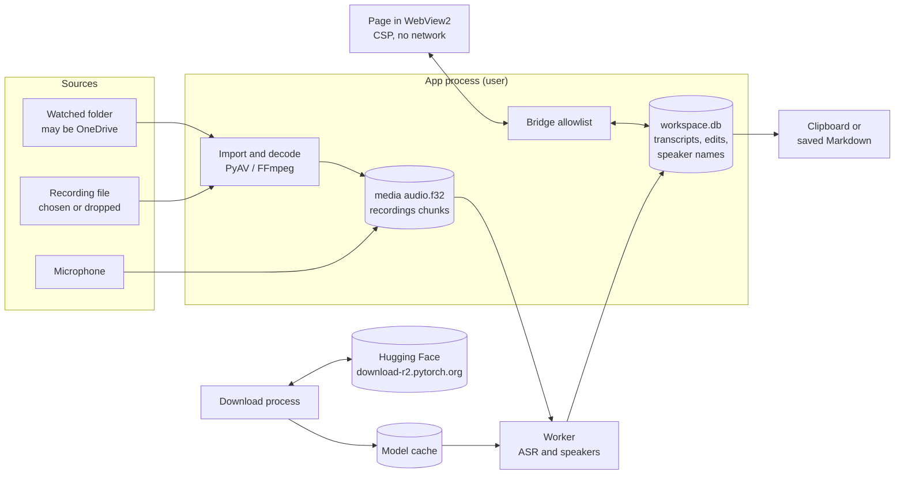

# Security model and threat assessment

This document describes how Unminute protects meeting recordings and transcripts: what it protects, from whom, the controls in place and the risks that remain. Its threat IDs are referenced by the security hardening slices in #111. Each slice updates this document when it lands.

It describes the app as at v0.4.3 (commit `7ec5bd4`). Controls marked **planned** name the #111 slice that delivers them. Nothing here is a certification or legal advice. Privacy Act 2020 points are marked "to confirm" for a privacy adviser.

## Scope and assumptions

In scope: the Meeting Workspace app (`workspace/`, `asr_engines.py`, `offline_guard.py`), its private runtime and installer (`packaging/`, `tools/build_package.py`), and the build and release pipeline (`.github/workflows/`).

Out of scope: Windows itself, account and sign-in security, endpoint protection, and the tools staff paste a handoff into (for example an AI assistant). Those are the firm's controls; this document states where Unminute depends on them.

Assumptions for a managed deployment:

- Windows 11, managed by Intune, with BitLocker enabled and enforced by a compliance policy.
- Staff sign in as standard users, not local administrators.
- Microsoft Defender is active. WebView2 is the Evergreen runtime and stays updated by Windows.
- Each person uses their own Windows account; laptops are not shared under one account.

If BitLocker is not enforced, threat T6 is unmitigated until the planned encryption at rest (C1 to C3) ships.

## System overview

| Component | What it is | Runs as |
| --- | --- | --- |
| App process | `runtime\pythonw.exe -m workspace`. Owns the database, settings and the window. | The signed-in user |
| Window | A WebView2 control showing the bundled page `workspace/ui/index.html` from a `file://` URL. | WebView2 child processes (`msedgewebview2.exe`) |
| Bridge | The Python methods the page may call, an exact-name allowlist (`workspace/api.py` `API_METHODS`), enforced by a dispatch guard (`workspace/shell.py`). | Inside the app process |
| Inference worker | A `multiprocessing` spawn child that loads one model at a time (`workspace/worker.py`). Connected by a pipe. | The signed-in user |
| Download process | A short-lived spawn child that downloads and verifies models on request (`workspace/setup.py`). The only Python process allowed to use the network. | The signed-in user |
| Workspace | `%LOCALAPPDATA%\whisper\workspace\`: `workspace.db` (SQLite, WAL), `media\<meeting id>\`, `recordings\<id>\`, `settings.json`, `templates.json`. | User's profile |
| Model cache | `%LOCALAPPDATA%\whisper-models\`. | User's profile |
| Install | `%LOCALAPPDATA%\Programs\WhisperWorkspace\versions\<version>\` (per user). **Planned (B6):** per machine under `%ProgramFiles%\Unminute`. | User's profile |

There are no listening sockets. The page is loaded from a `file://` URL, so pywebview does not start its local HTTP server (`workspace/shell.py`, header comment; verified by `tools/webview_trial.py`). Processes talk only through `multiprocessing` pipes created by the app.

## Data flow

Data leaves the app only through three user actions: copying a handoff to the clipboard, saving a handoff file, and opening one of three fixed help pages in the browser. Model downloads go out only when the user asks for them.

## Trust boundaries

| ID | Boundary | Why it matters |
| --- | --- | --- |
| TB1 | Page to Python bridge | Page script can call any allowlisted method. If the page were ever compromised, the bridge is what it could reach. |
| TB2 | Recording file to decoder | Recordings may come from clients or shared folders. FFmpeg parses them with the user's full rights. |
| TB3 | App to network | Only model downloads should cross. Telemetry from dependencies must not. |
| TB4 | User-writable disk to app | Install, model and workspace folders are writable by anything running as the user. |
| TB5 | Build and release to users | Whatever is published is installed on every laptop. |
| TB6 | App to clipboard and files | After a handoff leaves the app, the app no longer controls it. |
| TB7 | User to other accounts on the device | Other users, administrators and management agents. |

## Assets

| ID | Asset | Sensitivity |
| --- | --- | --- |
| AS1 | Meeting audio (decoded audio, recording chunks) | Confidential client information |
| AS2 | Transcripts, edits, edit history, reviewed snapshots | Confidential client information |
| AS3 | Speaker names, meeting titles, hold reasons, redaction words, handoff templates | Personal and client information |
| AS4 | Original file paths, watched-folder paths | Identifying metadata |
| AS5 | Hugging Face access token | Credential |
| AS6 | App code and private runtime | Integrity: code runs with the user's rights and has microphone access |
| AS7 | Model files | Integrity: the speaker model format can run code when loaded |
| AS8 | Release artifacts and build pipeline | Integrity for every installation |
| AS9 | Evidence of handling (receipts; **planned** audit log, C5) | Accountability |

## Attacker profiles

| ID | Profile | Example |
| --- | --- | --- |
| P1 | Author of a hostile media file | A crafted recording sent by email or dropped into a shared folder that is being watched |
| P2 | Script running in the page | Would need a rendering flaw; none is known (text-only rendering, strict CSP) |
| P3 | Malware running as the user | Any process the user starts |
| P4 | Thief of a lost or stolen laptop | Offline access to the disk |
| P5 | Other account, administrator or management agent | Another local user, IT support tools, backup agents |
| P6 | Repository insider or compromised maintainer account | Pushes code or replaces a release |
| P7 | Compromised dependency or model host | A malicious package version or tampered download |
| P8 | Network attacker | Intercepts or redirects download traffic |

## Threats and controls

Status: **in place** means shipped in v0.4.3; **planned** names the #111 slice. "Residual" is what remains after the planned controls.

| ID | Threat | Profile | In place | Planned | Residual |
| --- | --- | --- | --- | --- | --- |
| T1 | Page script calls the bridge to read content or trigger actions | P2 | Strict CSP (`connect-src 'none'`, no remote scripts); page renders text with `textContent` only; exact-name bridge allowlist; navigation lock to the UI folder; DevTools off; downloads and new windows refused | A2: remove the test-engine setting from production, strip page-supplied drop paths, allow only `index.html`, fail closed if the lock or guard cannot attach. A6: native Windows confirmation for recording, delete authority and discard | A compromised page could still read content through the bridge and place it on the clipboard |
| T2 | Hostile media file exploits the decoder to run code | P1 | Extension allowlist, 8 GB limit, regular files only | A3: decode in a separate short-lived process under a Job Object, container format allowlist | The decode process still runs as the user |
| T3 | Media file makes the decoder fetch network or local resources | P1 | Python socket guard in the app process | A3: `protocol_whitelist=file`. B7: firewall block for the runtime | None expected once the firewall rule is in place |
| T4 | File decodes to an enormous length and fills the disk | P1 | 8 GB input limit | A3: decoded-length cap and free-space check | Low |
| T5 | Path tricks (UNC, device, junction, mapped drive) cause network access or deletion outside the intended folder | P1, P3 | `workspace/safe_paths.py` refuses raw UNC and device paths; cleanup checks links, deletion authority and the original's hash before deleting an original | A3: re-check the resolved path, check reparse points before resolving, one mapped and network drive rule controlled by policy (A5) | Low |
| T6 | Offline access to the disk reads meetings | P4 | Relies on BitLocker (assumption) | C1 to C3: AES-256-GCM encryption of content with a DPAPI-protected key. IT: BitLocker compliance policy | Protected while the laptop is off or locked |
| T7 | Deleted content is recoverable from database free pages, the WAL, SSD remnants or temp files | P3, P4, P5 | `PRAGMA secure_delete=ON`; final cleanup truncates the WAL and runs VACUUM (`workspace/cleanup.py`) | A2: `temp_store=MEMORY` and the WebView2 profile kept inside the workspace and wiped at start. C3: crypto-erase (each cleanup confirmation destroys that meeting's key) | Content written by v0.4.x before C3 may remain in free disk space, protected by BitLocker only |
| T8 | Another account, an administrator or a backup agent reads the workspace | P5 | Inherited `%LOCALAPPDATA%` permissions stop other standard users | C1 to C3: content is unreadable without the user's DPAPI key | An administrator who runs code in the user's session can still read it |
| T9 | Malware running as the user reads content, records the microphone or tampers with the app | P3 | Windows shows its microphone-in-use indicator | B6: per-machine install that standard users cannot modify. A4 and B7: model integrity | Malware running as the user can read what the user can read. This relies on Defender and endpoint controls |
| T10 | Tampered model file runs code when loaded | P3, P7 | Every model file is pinned by revision and SHA-256 at download (`asr_engines.py`, `docs/MODEL_MANIFEST.md`) | A4: full re-hash of the speaker model before every load. B7: read-only machine-wide models. B9: load weights without full unpickling | Low once B7 ships |
| T11 | Content or telemetry leaves over the network | P3, P7 | Offline guard on Python sockets in the app and workers (`offline_guard.py`); dependency telemetry switched off before import; page CSP `connect-src 'none'`; WebView2 started with a switch that resolves no host names (whether WebView2 honours it is not yet verified, see `docs/WEBVIEW_TRIAL.md`) | A4: guard UDP and asyncio paths, self-test against a reserved address. B7: firewall block for the runtime | WebView2 child processes are shared with other apps and cannot be firewalled by path |
| T12 | Tampered or redirected model download | P7, P8 | HTTPS, and SHA-256 check before files are moved into place | A4: host allowlist including redirects; Windows certificate store so TLS inspection works without unsafe workarounds | Low |
| T13 | Hugging Face token is stolen | P3 | Stored in Windows Credential Manager; passed to the download process by pipe, never on a command line or in the environment; scrubbed from errors | A2: drop an inherited `HF_TOKEN` variable at start. A7: remove the earlier app's environment-variable fallback. B7: models pre-staged by IT so staff need no token | Any process running as the user can read a generic credential |
| T14 | A tampered release reaches laptops | P6, P7 | Installer checks the zip against its `.sha256` and every file against the package manifest | B1: hash-locked dependencies. B2: clean-tree, reproducible build with SBOM. B3: build in CI with signed provenance, published only after approval in a protected environment | The maintainer approves their own releases |
| T15 | Workflow injection or token misuse in CI | P6 | CI token is read-only | A1: least-privilege permissions, SHA-pinned actions, workflow lint, CodeQL for Actions, interim fix for the release tag input | Low |
| T16 | Known vulnerability in a shipped dependency or the Python runtime | P7 | Dependabot security alerts; routine version updates cover the root requirements file only | B1: pip-audit on every PR and daily, both requirement sets covered. B4: move to a Python version that still gets Windows binary releases | Time between disclosure and release |
| T17 | A handoff goes somewhere uncontrolled | Staff | Copy and save are explicit actions; copies are kept out of clipboard history and cloud clipboard; optional speaker-name replacement | A2: save dialog does not default to a synced folder or put the title in the file name. A5: optional timed clipboard clear. C5: copy and save recorded in the audit log | What staff do with a handoff after it leaves the app is a policy and training matter |
| T18 | A meeting is recorded without people knowing | Staff | A notice on the recording card | A6: a native confirmation before every recording, stored with the meeting; a recording indicator in the title and taskbar | Legal position to confirm (Privacy Act IPP 3) |
| T19 | Content is kept longer than needed | Staff | Two explicit cleanup confirmations; review reminders; holds need a reason | C6: reminders and an action-required state set by policy | Deletion stays a human decision by design (to confirm against IPP 9) |
| T20 | Nobody can show who exported or deleted what | Staff, P6 | Content-free receipts kept for 30 days | C5: content-free, hash-chained audit log with a Windows Event Log mirror | The same user could rebuild the local chain; the Event Log copy is the stronger record |
| T21 | A crash dump captures content | P5 | The app writes no logs; WebView2 is started with `--disable-breakpad` (not yet verified that it is honoured) | IT: Windows Error Reporting local-dump setting for the runtime. C7: packaged checks report any new dumps | To confirm on a managed device |
| T22 | Installer weakens endpoint protections | P1, P3 | Per-file manifest check | B6: no execution policy bypass, no execution from `%TEMP%`, no Mark of the Web removal, admin-only install folder | Low |
| T23 | WebView2 is not detected and pywebview falls back to the old IE engine, losing the CSP and the navigation lock | P2 | None | A2: refuse to start unless the WebView2 renderer is active | None |
| T24 | Code planted in the user-writable install or bytecode cache | P3 | Manifest checked at install time only | B2: precompiled bytecode, no runtime bytecode writes. B6: admin-only install folder | Low once B6 ships |

## Data inventory

| Data | Location (v0.4.3) | Protection today | Retention |
| --- | --- | --- | --- |
| Original recording | Wherever the user keeps it | None from the app | Never deleted, unless a watched folder grants deletion authority and the original's identity still matches |
| Decoded audio `audio.f32` | `workspace\media\<meeting id>\` | Inherited folder permissions | Until the review is confirmed or the meeting is discarded |
| Recording chunks and journal | `workspace\recordings\<id>\` | Inherited folder permissions | Removed after import; after a crash, kept until the user decides |
| Transcript, edits, history, snapshot, speaker names, redaction words, hold reasons, titles | `workspace.db` and its WAL | Deleted rows overwritten (`secure_delete`) | Until final cleanup, then the WAL is truncated and the file is compacted |
| Receipts | `workspace.db` | Content-free | 30 days |
| Watched-folder paths, path hashes, content fingerprints | `workspace.db` | Paths in plain text, others hashed | Paths until the folder is removed; fingerprints 120 days |
| `settings.json`, `templates.json` | `workspace\` | Plain files | Until changed; templates may contain names |
| Hugging Face token | Windows Credential Manager | DPAPI (by Windows) | Until removed in Setup |
| WebView2 profile | `%TEMP%` (pywebview default) | Private (InPrivate) mode | Removed on a clean close only |
| Clipboard copy | Windows session | Excluded from history and cloud sync | Until replaced |
| Saved handoff | Where the user saves it | None from the app | Not tracked |
| Models | `%LOCALAPPDATA%\whisper-models\` | SHA-256 verified | Until removed in Setup |

Planned changes to this inventory: C2 and C3 encrypt every content row and file listed above except the original recording and the saved handoff, and A2 moves the WebView2 profile into the workspace.

## What the controls do not cover

- **Malware running as the user.** Anything that runs as the signed-in user can do what the user can do, including reading meetings through Windows' own key protection. Endpoint protection is the control for this.
- **Administrators.** Someone with administrator rights who runs code in the user's session can read what the user can read.
- **Content after a handoff.** Once text is on the clipboard or in a saved file, the firm's other controls apply.
- **The page file and hibernation file.** Windows may write memory to disk. BitLocker protects these.
- **Forensic erasure.** On SSDs, ordinary deletion does not guarantee the old blocks are erased. The planned crypto-erase (C3) makes leftover encrypted data unreadable instead.

## Reporting a vulnerability

See [SECURITY.md](../SECURITY.md).
